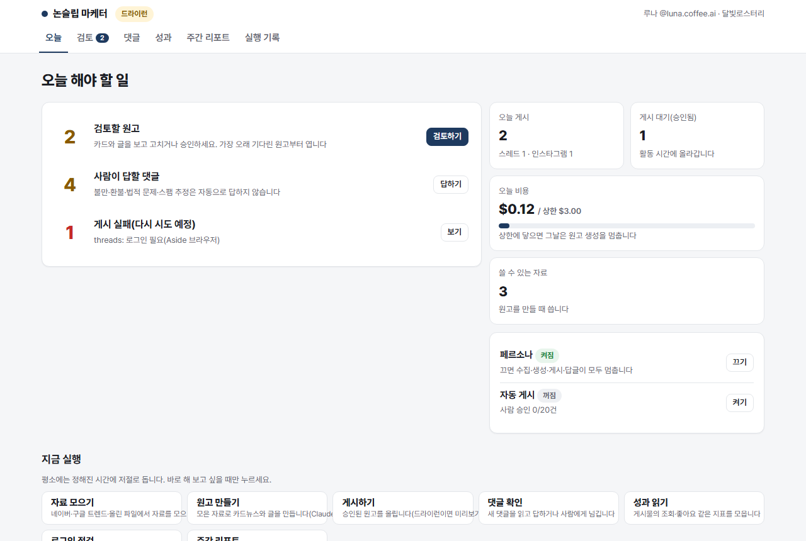
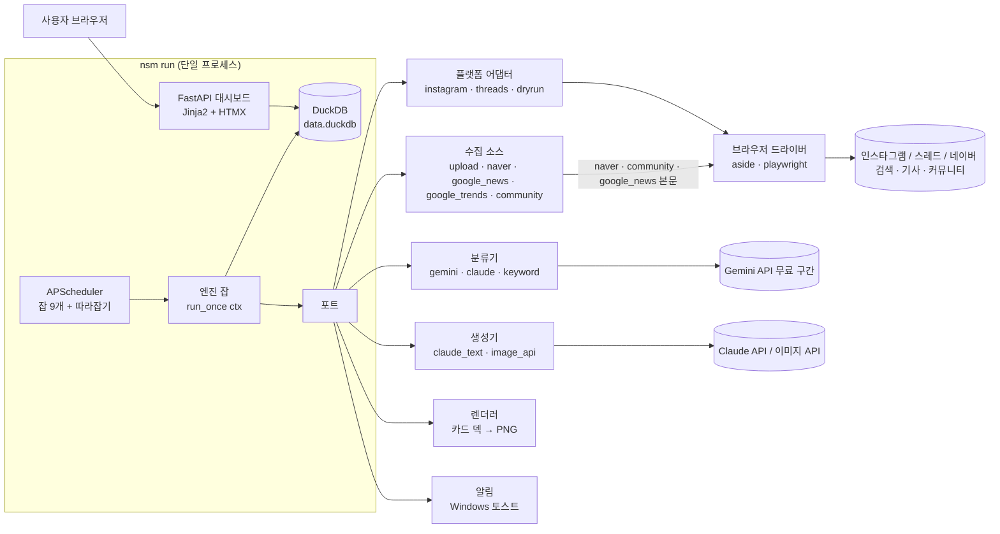

# 논슬립 마케터 (non-sleep-marketer)

**잠들지 않는 AI 가상 인플루언서 마케터.** 내 PC에 켜 두기만 하면, 내가 정한 가상 인물(페르소나)이 관심 주제의 자료를 모으고, 카드뉴스와 글을 만들어 인스타그램·스레드에 올리고, 댓글에 답하고, 성과를 정리합니다. 민감한 글과 댓글은 사람에게 넘기고, 법으로 정해진 가상인물·광고 표기는 자동으로 넣습니다.

> 상태: **실계정 운영 중** · 2026-10-13부터 · 버전 0.4.50(버전은 pyproject.toml이 원본) · 인스타그램·스레드. 빠지거나 미흡한 부분은 [known-gaps.md](docs/known-gaps.md)에 모아 두었습니다.



## 무엇으로 만들었나

| 역할 | 쓴 것 | 어디에 |
|---|---|---|
| 언어·실행 | Python 3.12, uv, Typer CLI(`nsm`) | `pyproject.toml`, `nsm/cli.py` |
| 저장 | DuckDB 파일(운영 표, 프리셋마다 하나), keyring(API 키는 Windows 자격 증명 관리자), Pydantic + YAML 설정 | `nsm/store/`, `nsm/config/` |
| 벡터 검색(RAG) | 외부 벡터 DB 없이 DuckDB `FLOAT[]` 임베딩 + `list_cosine_similarity` | `nsm/rag/search.py` |
| 대시보드 | FastAPI + uvicorn, Jinja2, HTMX | `nsm/app/` |
| 스케줄 | APScheduler 3 | `nsm/scheduler/` |
| 생성·답변·진단 | Claude API(anthropic SDK, 원고·답글·진단 `claude-sonnet-5-5`, 문서 질문 `claude-haiku-5-5`): 원고·답글, 문서 질문 답변, 화면 변경 실패 진단(글만 돌려주고 동작은 안 함) | `nsm/adapters/`(generator·diagnosis), `nsm/rag/answer.py` |
| 분류·임베딩 | Gemini REST를 httpx로 직접 호출(`gemini-3.5-flash-lite`, 임베딩 `gemini-embedding-2`). 실패하면 Claude 키가 있을 때 Claude(`claude-haiku-5-5`), 그다음 키워드 분류로 대체 | `nsm/adapters/classifier/`, `nsm/rag/gemini.py` |
| 카드 배경 그림(선택, 기본 꺼짐) | OpenAI 이미지 API(`gpt-image-2.5-flare`) | `nsm/adapters/generator/image_api.py` |
| 브라우저 | Aside 브라우저 + CLI(실계정 게시·댓글·지표) / Playwright Chromium(자료 수집: 수집 전용 프로필, 카드 HTML → PNG 렌더) | `nsm/adapters/drivers/`, `nsm/render/html_renderer.py` |
| 그 외 | Pillow(브랜드 이미지), pypdf·openpyxl(올린 자료 읽기), PowerShell(Windows 토스트 알림·폴더 선택 창) | `nsm/adapters/notify/windows.py`, `nsm/app/folder_picker.py` |
| 개발 | pytest, ruff, hatchling, GitHub Actions CI | `.github/workflows/ci.yml` |

모델 이름은 기본값이고 `config.yaml`의 `models`에서 바꿉니다. 따로 띄우는 서버나 클라우드 배포는 없습니다(내 PC 한 대, 필요한 건 API 키). 유료는 Claude API와 (켰을 때) 이미지 API 호출뿐이고, Gemini는 무료 구간의 하루 한도 안이면 0원입니다([비용](#비용-실측-기준-대략) 참고).

## 왜 만들었나

1인 브랜드 운영자나 소규모 마케터는 인스타그램·스레드를 꾸준히 운영해야 합니다. 그런데 자료를 찾고, 카드뉴스를 만들고, 플랫폼마다 형식을 바꿔 올리고, 댓글에 답하고, 무엇이 잘됐는지 결산하는 일을 사람이 다 하면 시간이 너무 많이 듭니다.
특히 **사람이 자는 동안이나 바쁠 때 달린 댓글**은 사람의 근무 시간에 묶여 있습니다.

AI에게 맡기면 시간은 줄지만 두 가지가 걱정됩니다. AI가 쓴 **내용을 믿을 수 있는지**, 그리고 AI 기본법과 공정위 추천·보증 심사지침에 따른 **AI·가상인물·광고 표기 의무**를 지키는지입니다.

이 프로젝트의 답은 하나입니다. **사람이 잠든 동안에도 일하되, 잘못돼도 되돌릴 수 있는 일만 자동으로 하고 위험한 건 사람에게 묻는다.**
근거 없는 주장·민감한 댓글·처음 20건은 사람이 보고, 표기는 끌 수 없게 코드로 넣습니다. 자세한 배경은 [PRD](docs/PRD.md)에 있습니다.

## 무엇을 하나

```
자료 모으기 → 원고 만들기 → 검토·승인 → 게시 → 댓글 답하기 → 성과·주간 리포트
 (네이버 블로그·뉴스,   (Claude: 카드뉴스   (처음 N건은      (Aside 브라우저로   (5분마다 확인,      (매일 지표,
  구글 뉴스·트렌드,     + 인스타 캡션        사람이 승인)     인스타·스레드)      민감한 건 사람에게)  월요일 리포트)
  올린 파일)            + 스레드 글)
```

| 단계 | 하는 일 |
|---|---|
| 자료 모으기 | 페르소나의 관심 주제로 네이버 블로그·뉴스, 구글 뉴스·트렌드, 지정한 커뮤니티 게시판을 찾고, 사용자가 올린 파일도 자료로 씁니다. 관련 있는 정보성 글만 고르고, 방문 후기·여행기·일기는 뺍니다. 고른 글은 원문 본문까지 읽습니다 |
| 원고 만들기 | 모은 자료로 카드뉴스(정보형·리스트형·비교형, 1080×1350)와 인스타 캡션·스레드 글을 만듭니다. 사실 주장마다 근거 자료를 연결하고, 페르소나 말투·이모지·금칙어 규칙을 코드로 검사합니다 |
| 검토·승인 | 대시보드에서 카드와 글을 나란히 보고, 문구·배경 사진·출처를 고쳐 승인합니다. 처음 정한 건수(보호 모드)까지는 반드시 사람이 승인합니다 |
| 게시 | 정한 게시 시간 안에서 플랫폼별 하루 개수와 간격을 지켜 올립니다. 올리기 전에 로그인된 계정이 설정한 계정과 같은지 확인합니다 |
| 댓글 | 칭찬·질문에는 페르소나 말투로 답합니다. 불만·환불·법적 문제·애매한 댓글은 사람에게 넘깁니다. 스팸은 스레드에서 숨깁니다 |
| 성과 | 게시물별 조회·좋아요·저장·공유, 팔로워, 비용을 모으고, 매주 월요일 잘된 콘텐츠와 다음 주 추천 주제를 정리합니다 |
| 문서 질문 | 프로젝트 문서·모은 자료·우리가 올린 글에서 근거를 찾아 답하는 챗봇(RAG, `/ask`). 답의 문장마다 근거 번호가 붙고, 근거가 없으면 모른다고 답합니다 |

## 어떻게 돌아가나

[architecture.md](docs/architecture.md) 1절의 그림입니다.



- **프로세스 하나**: `nsm run` 하나가 스케줄러(APScheduler)·엔진·대시보드(FastAPI, 127.0.0.1:8765)를 함께 띄우고, DB는 프리셋(브랜드)마다 DuckDB 파일 하나(`data.duckdb`)이고 이 프로세스만 엽니다. 따로 띄우는 서버는 없습니다.
- **잡**: 엔진의 잡은 `collect`(자료 모으기)·`generate`(원고 만들기)·`publish`(게시)·`reply`(댓글)·`health`(상태 점검)·`metrics`(성과 읽기)·`weekly_report`(주간 리포트)·`maintenance`(백업·정리)·`index`(문서 색인)이고(`nsm/engine/runner.py`), 스케줄러가 여기에 놓친 일을 다시 돌리는 `catch_up`을 더합니다(`nsm/scheduler/app.py`). 잡은 한 번에 하나씩 돕니다.
- **포트와 어댑터(헥사고날)**: 엔진은 벽의 콘센트(포트: 플랫폼·자료 소스·분류기·글 생성기·이미지 생성기·렌더러·알림·시계·비용, `nsm/ports/`)만 알고, 그 뒤에 꽂힌 플러그(어댑터: Claude·Gemini·Aside·Playwright·드라이런·Windows 알림, `nsm/adapters/`)는 모릅니다. 그래서 플러그만 바꿔 끼우면 됩니다. 예를 들어 분류기는 Gemini → Claude → 키워드 순서의 사슬이라, Gemini 호출이 실패하면(키 거절·한도 등) 엔진 코드를 건드리지 않고 다음 분류기로 넘어갑니다(ADR 0048). 드라이런과 실계정도 `settings.dry_run` 하나로 플랫폼 어댑터만 갈아 끼웁니다(드라이런 어댑터는 올리는 대신 미리보기 폴더에 저장, `nsm/runtime.py`).
- **원고의 일생**: `draft` → `pending_review`(사람 검토) 또는 `approved` → 게시 중(`publishing`, 게시 기록의 상태) → `published`, 언제든 `discarded`(폐기).
- **사람이 개입하는 곳**: 원고 검토·승인, 사람에게 넘어온 댓글, 설정(페르소나·브랜드·운영·API 키), 주간 리포트를 보고 다음 주 방향 정하기.

**안정성 장치**
- **잡 실패 격리·재시도**: 한 잡이 실패해도 실행 기록에 남기고 다른 잡은 예정대로 돕니다. 게시 실패는 15분·60분·240분 뒤 세 번 다시 시도하고(모두 4번), 그래도 실패하면 검토로 돌려 사람에게 넘깁니다.
- **요청 제한·로그인 풀림**: 플랫폼이 요청 제한(HTTP 429)을 걸면 멈추지 않고 정해진 시간 쉽니다(ADR 0038). 30분마다 로그인 상태를 점검해 풀렸으면 그 플랫폼만 멈추고 알립니다.
- **놓친 일 따라잡기**: 예정 시각에 PC가 꺼져 있었거나 절전이었으면, 켠 뒤 90초와 그 뒤 30분마다 오늘 못 한 일을 한 번 돌립니다(ADR 0066).
- **매일 백업**: 새벽 4시 30분에 DB를 백업해 최근 7개를 남기고, 설정에서 고른 복사 폴더(구글 드라이브·OneDrive 등)에도 한 부 더 둡니다(ADR 0074).
- **API 키 점검**: 하루 한 번 키마다 비용 없는 조회로 자동 확인하고, 적어 둔 만료일 7·3·1일 전과 당일에 알립니다. 실행 중 키가 거절되면 바로 알립니다(ADR 0077).

## 하루가 이렇게 흘러갑니다

| 시각 (활동 시간 기준) | 자동으로 하는 일 |
|---|---|
| 활동 시간 시작 20분 뒤 (마지막 활동 시간 시작 20분 뒤에 한 번 더) | 자료 모으기 |
| 활동 시간 시작 50분 뒤 | 원고 만들기 → 검토 대기 또는 (자동 게시가 켜져 있고 기준을 통과하면) 게시 대기 |
| 게시 시간 안에서 30분마다 | 게시 (인스타 하루 1개, 스레드 하루 2개, 같은 플랫폼은 3시간 간격) |
| 5분마다 | 댓글 확인·답글 (인스타그램은 30분, 스레드는 15분보다 자주 보지 않음) |
| 30분마다 | 상태 점검 (로그인, API 키 하루 한 번) |
| 새벽 3시 10분 | 성과 읽기 (지표·팔로워) |
| 새벽 4시 30분 | 백업·정리 |
| 저녁 8시 | 문서 색인 (문서 질문용) |
| 월요일 8시 | 주간 리포트 |

예를 들어 `nsm init`이 권하는 활동 시간 "09:00-12:00, 18:00-23:00"이면 자료 모으기는 9시 20분·18시 20분, 원고 만들기는 9시 50분쯤입니다. 시각마다 무작위로 조금씩 흔듭니다(자료 모으기는 ±30분).
시각은 대시보드 **설정**에서 바꿉니다(활동 시간, 게시 시간, 하루 게시 수, 댓글 확인 간격, 따라잡을 일). 사람이 하는 일은 **매일 아침 "오늘" 화면의 할 일 목록을 위에서부터 처리하는 것**입니다.

## 지금 어디까지 왔나

| 태그 | 날짜 | 무엇이 들어갔나 |
|---|---|---|
| `v0.1-dryrun` | 2026-10-11 | 드라이런 MVP: 모으기·만들기·게시(미리보기 저장)·댓글·지표 잡, 대시보드, 스케줄러 |
| `v0.2-live` | 2026-10-13 | 실계정 연결(스레드·인스타그램), 주간 리포트, 카드뉴스 렌더러. 이날 실계정 첫 실행 |
| `v0.3-mvp` | 2026-10-13 | 원고 품질, 카드 편집 화면, 대시보드 디자인 |
| `v0.4-quality` | 2026-10-15 | 계약 테스트, 품질 체크리스트, 카드 스타일 3종 |
| 지금 | 0.4.50 | 운영하며 고친 안정화·문서 질문(RAG)·장애 화면·백업·API 키 점검 |

숫자로 보면 (저장소 기준, 2026-11-24)
- 테스트 **1,618개** (`uv run pytest --co -q`, 실계정 계약 테스트 13개는 기본 제외)
- 설계 결정 기록(ADR) **77개** ([docs/adr/](docs/adr/README.md))
- 배치 **93개**, 배치마다 devlog 한 편 ([docs/devlog/](docs/devlog/README.md))
- 운영 중 장애 기록 **16건** ([docs/incidents/](docs/incidents/README.md))

남은 과제는 [known-gaps.md](docs/known-gaps.md)에 있습니다.

## 시작하기

### 필요한 것

- Windows 11 PC (프로그램이 도는 동안 켜 두기)
- [uv](https://docs.astral.sh/uv/), Python 3.12
- Claude API 키 (원고·답글, 필수)
- Gemini API 키 (자료·댓글 분류, 무료 구간이면 0원. 없으면 Claude로 분류)
- [Aside](https://docs.aside.com/help/developers) 브라우저와 CLI (실계정 게시·댓글). 게시할 인스타그램(프로페셔널 계정)·스레드 계정으로 로그인해 둡니다
- OpenAI API 키 (카드 배경 이미지 생성, 선택. 없으면 브랜드 색 배경)

### 설치와 실행

```powershell
git clone https://github.com/idktomorrow/non-sleep-marketer.git
cd non-sleep-marketer
uv sync
uv run playwright install chromium

uv run nsm init      # 설정 마법사: 위험 고지 동의, 브랜드, 페르소나, API 키(입력이 화면에 안 보임), 계정
uv run nsm doctor    # 환경 점검. FAIL이 없으면 준비 끝
uv run nsm run       # 실행. 대시보드: http://127.0.0.1:8765 (끄기: Ctrl+C)
```

1. **드라이런으로 먼저 보기**: 처음 설정은 드라이런입니다. 실제로 올리지 않고 `%USERPROFILE%\.nsm\preview\`에 카드와 글을 저장합니다.
2. **실계정으로 바꾸기**: `uv run nsm init`에서 드라이런을 "아니오"로 답하면 게시할 핸들과 보호 모드 건수를 묻습니다. 또는 `nsm run`을 끄고 `%USERPROFILE%\.nsm\config.yaml`에서 `settings.dry_run: false`로 바꾸고, `settings.accounts`에 게시할 핸들을 적은 뒤 다시 실행합니다. 대시보드 위쪽 표시가 "실계정"이면 됩니다.
3. **처음 N건 승인하기**: 보호 모드(기본 20건) 동안은 검토 화면에서 하나씩 확인하고 승인합니다. 다 승인한 뒤 "오늘" 화면에서 **자동 게시**를 켜면, 기준을 통과한 원고는 그때부터 자동으로 올라갑니다.
4. **PC를 켤 때 자동 시작**: `uv run nsm install-autostart` (해제: `uv run nsm uninstall-autostart`)

자세한 사용법은 **[사용설명서](docs/user-guide.md)**에 있습니다.

## 대시보드

| 메뉴 | 할 수 있는 일 |
|---|---|
| 오늘 | 오늘 해야 할 일(검토할 원고, 사람이 답할 댓글, 게시 실패, 로그인 필요, API 키 만료), 오늘 게시·비용, 페르소나·자동 게시 켜기/끄기, 작업 바로 실행 |
| 검토 | 카드와 글을 나란히 보고 문구·배경 사진·출처 고치기, 미리보기, 승인·폐기 |
| 게시 대기 | 승인돼 올라갈 원고와 순서, 최근 7일 게시. 검토로 되돌려 고치거나 폐기 |
| 댓글 | 사람에게 넘어온 댓글에 직접 답하거나 처리 완료 |
| 자료 | 브랜드 자료 파일 올리기(바로 읽기 확인), 올린 파일과 모은 자료의 판정·쓰인 원고 |
| 성과 · 주간 리포트 | 게시물별 지표, 팔로워, 댓글 처리, 비용, 주간 결산 |
| 문서 질문 | 문서·모은 자료·우리가 올린 글에 질문하고 근거와 함께 답 보기, 검색 측정 |
| 장애 | 실패한 작업의 원인 분류·증거 화면·할 일 |
| 실행 기록 | 작업마다 언제 돌았고 무엇을 했는지 |
| 종 모양 (오른쪽 위) | 알림함: 검토할 원고, 확인할 댓글, 로그인 필요, 게시 실패, 작업 완료. 누르면 그 화면으로, 전체 읽음 |
| 설정 | 페르소나(이름·인물상·말투·관심 주제·금칙어), 브랜드(이름·업종·제품·핵심 메시지·색), 운영(활동·게시 시간, 하루 게시 수, 비용 상한, 댓글 확인 간격, 따라잡기), 백업 복사 폴더, API 키와 만료일. 저장하면 바로 반영 |

자료·문서 질문·장애·실행 기록 메뉴와 설정의 따라잡기·백업 복사 폴더는 "고급" 보기에서 보입니다. 드라이런/실계정 전환, 게시 계정, 보호 모드 건수는 사고를 막기 위해 설정 화면에서 바꾸지 않습니다(`nsm init` 또는 `nsm run`을 끄고 `config.yaml`).

## 안전장치

- **법정 표기 자동 삽입(끌 수 없음)**: 글 첫 줄에 "AI 가상인물 포함 게시물"(공정위 예규의 짧은 예시 문구 "가상인물 포함" 기반, ADR 0053), 카드에 "가상인물" 배지, AI 배경에는 "AI 생성 이미지", 협찬이면 `#광고`.
- **체험 후기 금지**: 가상 인물이 "써봤는데", "내돈내산"처럼 직접 써 본 척하는 표현은 기본 금칙 패턴으로 막습니다.
- **검토로 보내는 기준**: 보호 모드, 자동 게시 꺼짐, 근거 없는 사실 주장, 관련성 0.8 미만, 금칙어, 말투·이모지 규칙 위반(한 번 다시 만든 뒤에도), 게시 4회 실패.
- **계정 확인**: 로그인된 계정이 설정한 핸들과 다르면 게시하지 않습니다.
- **비용 상한**: 하루 비용이 상한(기본 3달러)에 닿으면 그날은 원고를 만들지 않습니다.
- **키 보관**: API 키는 파일이 아니라 Windows 자격 증명 관리자에만 둡니다. 대시보드는 내 PC(127.0.0.1)에서만 열립니다.

> 인스타그램·스레드·네이버 약관은 자동화 도구 사용을 제한합니다. 이 도구는 빈도를 낮추고 무작위 간격을 두지만 계정 제한 위험을 없애지는 못합니다. 첫 실행 때 이 위험에 동의해야 설정이 저장됩니다.

## 비용 (실측 기준 대략)

| 항목 | 비용 |
|---|---|
| 원고 1건 (Claude) | 약 3~6센트 |
| 자동 답글 1개 (Claude) | 약 0.5센트 |
| 자료·댓글 분류 (Gemini 무료 구간) | 0원 (하루 한도 안. 없으면 Claude Haiku 1건 약 0.01센트) |
| 게시·댓글 확인·지표 (Aside 브라우저) | 0원 |
| 배경 이미지 1장 (OpenAI, 선택) | 약 5센트 |

하루 원고 2~3건 기준으로 하루 10~20센트 안팎입니다. 실제 비용은 대시보드 "오늘"과 "성과"에서 봅니다.

## 문서 지도

| 알고 싶은 것 | 문서 |
|---|---|
| 쓰는 법 | [user-guide.md](docs/user-guide.md) |
| 빠지거나 미흡한 부분 | [known-gaps.md](docs/known-gaps.md) |
| 무엇을 왜 만드나 | [PRD](docs/PRD.md) |
| 지금 어떻게 돌아가나 | [architecture.md](docs/architecture.md) |
| 처음 합류했다 (개발) | [onboarding.md](docs/onboarding.md) |
| 일하는 방식(배치·DoD·기록) | [process.md](docs/process.md) |
| 인터페이스·소유권 약속 | [contracts.md](docs/contracts.md) |
| 이슈 목록 | [issues.md](docs/issues.md) · [GitHub Issues](https://github.com/idktomorrow/non-sleep-marketer/issues) |
| 왜 이렇게 정했나 | [adr/](docs/adr/README.md) · [planning-decisions](docs/planning-decisions.md) · [mvp-review](docs/mvp-review.md) |
| 운영 중 겪은 장애 | [incidents/](docs/incidents/README.md) |
| 진행 기록 | [devlog/](docs/devlog/README.md) · [retro/](docs/retro/README.md) · [CHANGELOG](CHANGELOG.md) |
| 외부 서비스 확인 결과 | [day1-verification.md](docs/day1-verification.md) |
| 모르는 말 | [glossary.md](docs/glossary.md) |

## 개발

```powershell
uv run ruff check . ; uv run ruff format --check .
uv run pytest                 # 실계정 계약 테스트(-m contract)는 기본 제외
uv run python scripts/dashboard_demo.py   # 예시 데이터로 대시보드만 띄우기(http://127.0.0.1:8799, API 비용 없음)
```

스택은 위 [무엇으로 만들었나](#무엇으로-만들었나)를 보세요. 작업은 배치 단위로 PR을 올리고, 완료 기준은 [CLAUDE.md](CLAUDE.md)와 [process.md](docs/process.md)에 있습니다.

## English summary

**non-sleep-marketer** is an AI virtual-influencer marketer that runs as a single local process on your own Windows PC.
It collects material on a persona's topics, writes card news and posts with Claude, publishes to Instagram and Threads, replies to comments, and writes a weekly report.
**Why**: a solo brand owner cannot keep up with research, design, multi-platform posting, overnight comments and reporting, and AI content raises trust and legal-labeling concerns (Korean AI Basic Act, Korea Fair Trade Commission endorsement guidelines).
**Principle**: work while the owner sleeps, but automate only what can be undone; anything risky goes to a human (first 20 posts, unsupported claims, sensitive comments).
**Architecture**: one `nsm run` process hosts an APScheduler job runner, the engine and a FastAPI + HTMX dashboard on 127.0.0.1, backed by one DuckDB file per preset.
The engine talks only to ports; adapters (Claude, Gemini, Aside/Playwright browsers, dry-run, Windows toast) plug in behind them, so the classifier can fall back from Gemini to Claude and dry-run vs live is just an adapter swap.
Reliability: isolated job failures with retries, rate-limit back-off, login-loss detection, catch-up of missed jobs, daily backups and API-key expiry alerts.
A RAG chatbot (`/ask`) answers questions from project docs, collected sources and our own posts, with citations.
**Stack**: Python 3.12 + uv + Typer; DuckDB (tables and RAG vector search via `list_cosine_similarity`, no external vector DB); FastAPI + Jinja2 + HTMX; APScheduler 3; Claude API (generation, RAG answers, failure diagnosis); Gemini REST via httpx (classification, embeddings); optional OpenAI image API; Aside browser for publishing and comments, Playwright Chromium for collection and card rendering; pytest, ruff, GitHub Actions. Nothing to deploy (one PC plus API keys); paid calls are Claude and the optional image API, with Gemini on its free tier.
**Status**: running on live accounts since 2026-10-13, version 0.4.50 (pyproject.toml is the source), 1,719 tests, 81 ADRs, 97 batches with devlogs, 17 incident write-ups.
Keys stay in the Windows Credential Manager; required AI, virtual-person and ad labels are inserted automatically and cannot be turned off.
