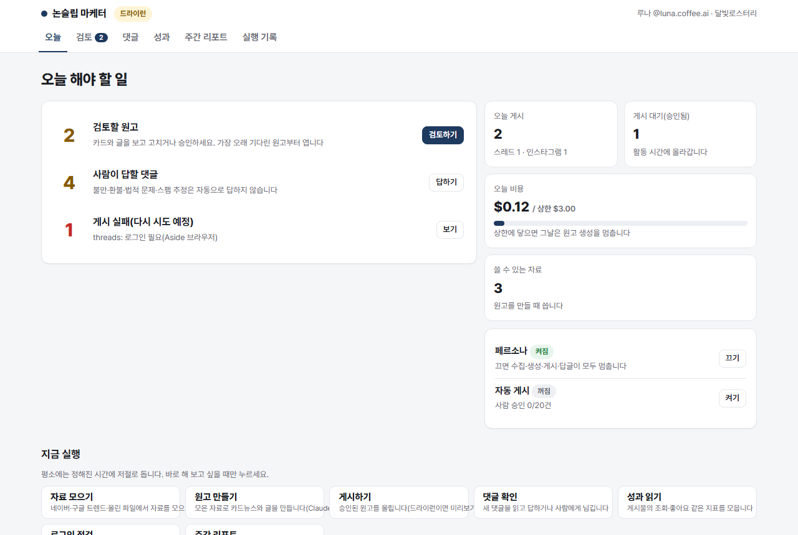

# 논슬립 마케터 (non-sleep-marketer)

**잠들지 않는 AI 가상 인플루언서 마케터.** 내 PC에 켜 두기만 하면, 내가 정한 가상 인물(페르소나)이 관심 주제의 자료를 모으고, 카드뉴스와 글을 만들어 인스타그램·스레드에 올리고, 댓글에 답하고, 성과를 정리합니다. 민감한 글과 댓글은 사람에게 넘기고, 법으로 정해진 가상인물·광고 표기는 자동으로 넣습니다.

> 상태: **실계정 운영 중** (`v0.4-quality`, 2026-10-15). 스레드·인스타그램에 실제로 게시하고 댓글·지표를 다룹니다. 2주차 품질 배치(계약 테스트 S-β, 품질 체크리스트 S-γ, 카드 스타일 clean·photo·illust S8)까지 들어갔습니다. 빠지거나 미흡한 부분은 [known-gaps.md](docs/known-gaps.md)에 모아 두었습니다.



## 무엇을 하나

```
자료 모으기 → 원고 만들기 → 검토·승인 → 게시 → 댓글 답하기 → 성과·주간 리포트
 (네이버 블로그·뉴스,   (Claude: 카드뉴스   (처음 N건은      (Aside 브라우저로   (5분마다 확인,      (매일 지표,
  구글 뉴스·트렌드,     + 인스타 캡션        사람이 승인)     인스타·스레드)      민감한 건 사람에게)  월요일 리포트)
  올린 파일)            + 스레드 글)
```

| 단계 | 하는 일 |
|---|---|
| 자료 모으기 | 페르소나의 관심 주제로 네이버 블로그·뉴스를 검색합니다. 관련 있는 정보성 글만 고르고, 방문 후기·여행기·일기는 뺍니다. 고른 글은 원문 본문까지 읽습니다 |
| 원고 만들기 | 모은 자료로 카드뉴스(정보형·리스트형·비교형, 1080×1350)와 인스타 캡션·스레드 글을 만듭니다. 사실 주장마다 근거 자료를 연결하고, 페르소나 말투·이모지·금칙어 규칙을 코드로 검사합니다 |
| 검토·승인 | 대시보드에서 카드와 글을 나란히 보고, 문구·배경 사진·출처를 고쳐 승인합니다. 처음 정한 건수(보호 모드)까지는 반드시 사람이 승인합니다 |
| 게시 | 정한 게시 시간 안에서 플랫폼별 하루 개수와 간격을 지켜 올립니다. 올리기 전에 로그인된 계정이 설정한 계정과 같은지 확인합니다 |
| 댓글 | 칭찬·질문에는 페르소나 말투로 답합니다. 불만·환불·법적 문제·애매한 댓글은 사람에게 넘깁니다. 스팸은 스레드에서 숨깁니다 |
| 성과 | 게시물별 조회·좋아요·저장·공유, 팔로워, 비용을 모으고, 매주 월요일 잘된 콘텐츠와 다음 주 추천 주제를 정리합니다 |

## 하루가 이렇게 흘러갑니다

| 시각 (기본 설정 예) | 자동으로 하는 일 |
|---|---|
| 0시 20분쯤 | 자료 모으기 |
| 0시 50분쯤 | 원고 만들기 → 검토 대기 또는 (자동 게시가 켜져 있고 기준을 통과하면) 게시 대기 |
| 08~23시, 30분마다 | 게시 (인스타 하루 1개, 스레드 하루 2개, 같은 플랫폼은 3시간 간격) |
| 5분마다 | 댓글 확인·답글 |
| 30분마다 | 로그인 상태 점검 (풀리면 그 플랫폼을 멈추고 알림) |
| 새벽 3시 | 지표·팔로워 기록 |
| 월요일 8시 | 주간 리포트 |

시각은 대시보드 **설정**에서 바꿉니다(활동 시간, 게시 시간, 하루 게시 수, 댓글 확인 간격). 사람이 하는 일은 **매일 아침 "오늘" 화면의 할 일 목록을 위에서부터 처리하는 것**입니다.

## 시작하기

### 필요한 것

- Windows 11 PC (프로그램이 도는 동안 켜 두기)
- [uv](https://docs.astral.sh/uv/), Python 3.12
- Claude API 키 (원고·답글, 필수)
- Gemini API 키 (자료·댓글 분류, 무료 구간이면 0원. 없으면 Claude로 분류)
- [Aside](https://docs.aside.com/help/developers) 브라우저와 CLI (실계정 게시·댓글). 게시할 인스타그램(프로페셔널 계정)·스레드 계정으로 로그인해 둡니다
- OpenAI API 키 (카드 배경 이미지 생성, 선택. 없으면 브랜드 색 배경)

### 설치와 실행

```powershell
git clone https://github.com/idktomorrow/non-sleep-marketer.git
cd non-sleep-marketer
uv sync
uv run playwright install chromium

uv run nsm init      # 설정 마법사: 위험 고지 동의, 브랜드, 페르소나, API 키(입력이 화면에 안 보임), 계정
uv run nsm doctor    # 환경 점검. FAIL이 없으면 준비 끝
uv run nsm run       # 실행. 대시보드: http://127.0.0.1:8765 (끄기: Ctrl+C)
```

1. **드라이런으로 먼저 보기**: 처음 설정은 드라이런입니다. 실제로 올리지 않고 `%USERPROFILE%\.nsm\preview\`에 카드와 글을 저장합니다.
2. **실계정으로 바꾸기**: `%USERPROFILE%\.nsm\config.yaml`에서 `settings.dry_run: false`로 바꾸고, `settings.accounts`에 게시할 핸들을 적은 뒤 다시 실행합니다. 대시보드 위쪽 표시가 "실계정"이면 됩니다.
3. **처음 N건 승인하기**: 보호 모드(기본 20건) 동안은 검토 화면에서 하나씩 확인하고 승인합니다. 다 승인한 뒤 "오늘" 화면에서 **자동 게시**를 켜면, 기준을 통과한 원고는 그때부터 자동으로 올라갑니다.
4. **PC를 켤 때 자동 시작**: `uv run nsm install-autostart` (해제: `uv run nsm uninstall-autostart`)

자세한 사용법은 **[사용설명서](docs/user-guide.md)**에 있습니다.

## 대시보드

| 메뉴 | 할 수 있는 일 |
|---|---|
| 오늘 | 오늘 해야 할 일(검토할 원고, 사람이 답할 댓글, 게시 실패, 로그인 필요), 오늘 게시·비용, 페르소나·자동 게시 켜기/끄기, 작업 바로 실행 |
| 검토 | 카드와 글을 나란히 보고 문구·배경 사진·출처 고치기, 미리보기, 승인·폐기 |
| 자료 | 브랜드 자료 파일 올리기(바로 읽기 확인), 올린 파일과 모은 자료의 판정·쓰인 원고 |
| 게시 대기 | 승인돼 올라갈 원고와 순서, 최근 7일 게시. 검토로 되돌려 고치거나 폐기 |
| 종 모양 (오른쪽 위) | 알림함: 검토할 원고, 확인할 댓글, 로그인 필요, 게시 실패, 작업 완료. 누르면 그 화면으로, 전체 읽음 |
| 댓글 | 사람에게 넘어온 댓글에 직접 답하거나 처리 완료 |
| 성과 · 주간 리포트 | 게시물별 지표, 팔로워, 댓글 처리, 비용, 주간 결산 |
| 실행 기록 | 작업마다 언제 돌았고 무엇을 했는지 |
| 설정 | 페르소나(이름·인물상·말투·관심 주제·금칙어), 브랜드(이름·업종·제품·핵심 메시지·색), 운영(활동·게시 시간, 하루 게시 수, 비용 상한, 댓글 확인 간격). 저장하면 바로 반영 |

드라이런/실계정 전환, 게시 계정, API 키, 보호 모드 건수는 사고를 막기 위해 설정 화면에서 바꾸지 않습니다(`nsm init` 또는 `config.yaml`).

## 안전장치

- **법정 표기 자동 삽입(끌 수 없음)**: 글 첫 줄에 "인공지능(AI)을 기반으로 생성된 가상인물이 포함된 게시물입니다"(공정위 예규 문구), 카드에 "가상인물" 배지, AI 배경에는 "AI 생성 이미지", 협찬이면 `#광고`.
- **체험 후기 금지**: 가상 인물이 "써봤는데", "내돈내산"처럼 직접 써 본 척하는 표현은 기본 금칙 패턴으로 막습니다.
- **검토로 보내는 기준**: 보호 모드, 자동 게시 꺼짐, 근거 없는 사실 주장, 관련성 0.8 미만, 금칙어, 말투·이모지 규칙 위반(한 번 다시 만든 뒤에도), 게시 4회 실패.
- **계정 확인**: 로그인된 계정이 설정한 핸들과 다르면 게시하지 않습니다.
- **비용 상한**: 하루 비용이 상한(기본 3달러)에 닿으면 그날은 원고를 만들지 않습니다.
- **키 보관**: API 키는 파일이 아니라 Windows 자격 증명 관리자에만 둡니다. 대시보드는 내 PC(127.0.0.1)에서만 열립니다.

> 인스타그램·스레드·네이버 약관은 자동화 도구 사용을 제한합니다. 이 도구는 빈도를 낮추고 무작위 간격을 두지만 계정 제한 위험을 없애지는 못합니다. 첫 실행 때 이 위험에 동의해야 설정이 저장됩니다.

## 비용 (실측 기준 대략)

| 항목 | 비용 |
|---|---|
| 원고 1건 (Claude) | 약 3~6센트 |
| 자동 답글 1개 (Claude) | 약 0.5센트 |
| 자료·댓글 분류 (Gemini 무료 구간) | 0원 (하루 한도 안. 없으면 Claude Haiku 1건 약 0.01센트) |
| 게시·댓글 확인·지표 (Aside 브라우저) | 0원 |
| 배경 이미지 1장 (OpenAI, 선택) | 약 5센트 |

하루 원고 2~3건 기준으로 하루 10~20센트 안팎입니다. 실제 비용은 대시보드 "오늘"과 "성과"에서 봅니다.

## 문서 지도

| 알고 싶은 것 | 문서 |
|---|---|
| 쓰는 법 | [user-guide.md](docs/user-guide.md) |
| 빠지거나 미흡한 부분 | [known-gaps.md](docs/known-gaps.md) |
| 무엇을 왜 만드나 | [PRD](docs/PRD.md) |
| 지금 어떻게 돌아가나 | [architecture.md](docs/architecture.md) |
| 처음 합류했다 (개발) | [onboarding.md](docs/onboarding.md) |
| 일하는 방식(배치·DoD·기록) | [process.md](docs/process.md) |
| 인터페이스·소유권 약속 | [contracts.md](docs/contracts.md) |
| 이슈 목록 | [issues.md](docs/issues.md) · [GitHub Issues](https://github.com/idktomorrow/non-sleep-marketer/issues) |
| 왜 이렇게 정했나 | [adr/](docs/adr/README.md) · [planning-decisions](docs/planning-decisions.md) · [mvp-review](docs/mvp-review.md) |
| 진행 기록 | [devlog/](docs/devlog/README.md) · [retro/](docs/retro/README.md) · [CHANGELOG](CHANGELOG.md) |
| 외부 서비스 확인 결과 | [day1-verification.md](docs/day1-verification.md) |
| 모르는 말 | [glossary.md](docs/glossary.md) |

## 개발

```powershell
uv run ruff check . ; uv run ruff format --check .
uv run pytest                 # 실계정 계약 테스트(-m contract)는 기본 제외
uv run python scripts/dashboard_demo.py   # 예시 데이터로 대시보드만 띄우기(http://127.0.0.1:8799, API 비용 없음)
```

로컬 단일 프로세스(Python 3.12, FastAPI + Jinja + HTMX, APScheduler, DuckDB)입니다. 작업은 배치 단위로 PR을 올리고, 완료 기준은 [CLAUDE.md](CLAUDE.md)와 [process.md](docs/process.md)에 있습니다.
