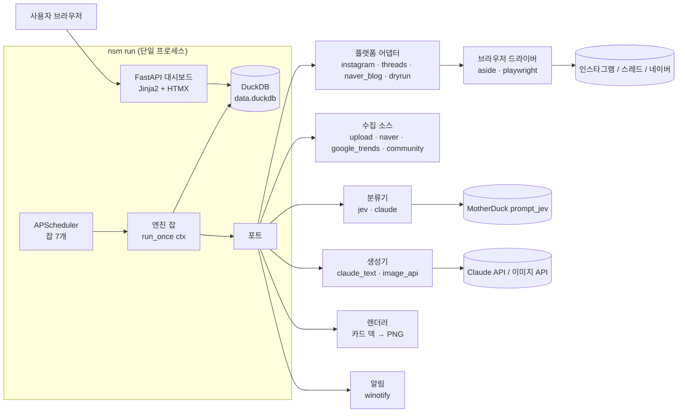
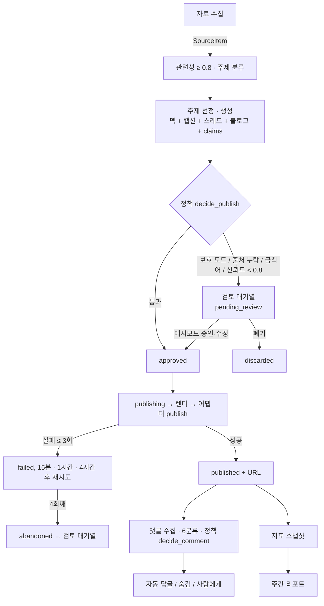
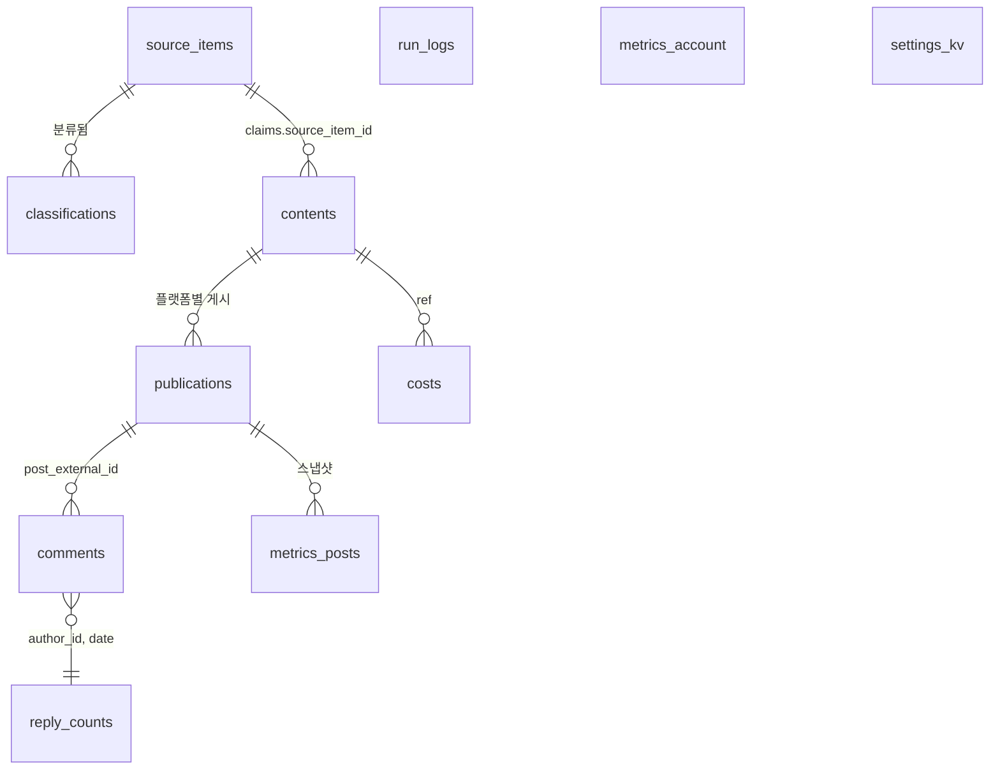

# 현재 구현 아키텍처

> 갱신: 2026-10-11 (배치 C 완료) · 약속은 [contracts.md](contracts.md), 이 문서는 "지금 실제로 어떻게 돌아가는가". 배치마다 맨 아래 구현 상태 표를 갱신한다.

## 1. 한 장 요약

사용자 PC에서 `nsm run` 하나가 세 가지를 동시에 띄운다: 스케줄러(잡 7개), 엔진(포트를 통해 외부 접근), 로컬 대시보드(FastAPI, 127.0.0.1:8765). DB는 DuckDB 파일 하나이고 이 프로세스만 연다.

## 2. 잡과 주기

| 잡 | 주기 | 입력 → 출력 |
|---|---|---|
| health | 30분 | 어댑터 `health()` → 로그아웃 시 알림, 플랫폼 중단 플래그 |
| collect | 하루 2회 ±30분 | 소스 → `source_items`(중복 제거) → 관련성·주제 `classifications` |
| generate | 하루 1회 | 주제 선정(14일 중복 제외) → `contents`(draft → pending_review / approved) |
| publish | 게시 슬롯 | approved 1건 → publishing → 렌더 → 어댑터 → published + `publications` |
| reply | 10분 ±3분 | 새 댓글 → 6분류 → 답글 / 숨김 / 에스컬레이션, `reply_counts` |
| metrics | 하루 1회 | 최근 7일 게시물·계정 지표 스냅샷 |
| weekly_report | 주 1회 | 성과 요약·추천 주제 → 대시보드 + md |

## 3. 데이터 흐름

콘텐츠 상태: `draft → pending_review → approved → publishing → published | failed → abandoned`, 어디서든 `discarded`. 재시작 시 `publishing` 잔여 건은 `pending_review`로(이중 게시 방지).

## 4. DB 테이블 관계

## 5. 디렉터리 지도

[contracts.md 1절](contracts.md#1-디렉터리와-소유권)이 원본. 핵심만:
`nsm/domain`(모델·정책·상태 머신) → `nsm/ports`(Protocol) ← `nsm/adapters/*`(구현) · `nsm/engine`(잡) · `nsm/store`(DuckDB) · `nsm/app`(대시보드) · `nsm/scheduler` · `nsm/render` + `nsm/templates`(서브).

## 6. 구현 상태

범례: 계획 / 구현 중 / 완료 / 테스트됨(경계 1·2·3 중 어느 것). 배치 PR마다 갱신.

| 모듈 | 상태 | 테스트 | 배치 | 비고 |
|---|---|---|---|---|
| `nsm/cli.py` | 구현 중 | 경계 밖(CLI 테스트) | A | doctor·help 동작, 나머지 명령은 해당 배치 안내 후 종료 |
| `nsm/domain/models.py` | 완료 | 단위 | A | 동결. ADR 0009 반영 |
| `nsm/ports/` | 완료 | 단위(fakes 적합성) | A | 동결. `CostSink` 추가 |
| `nsm/store/` (스키마·리포지토리) | 완료 | 단위 | A(스키마), C | `Repository`: 중복 제거, 상태 전이 검사, 게시 재시도 조회, 답글 횟수, 비용 합계, 실행 로그 |
| `nsm/config/` (YAML·keyring·마법사) | 완료 | 단위 | C | 마법사는 `WizardIO`로 입출력 분리, 키는 환경 변수 → keyring 순 |
| `nsm/adapters/sources/` 4종 | 계획 | - | D1 | |
| `nsm/adapters/classifier/` jev·claude | 계획 | - | D1 | |
| `nsm/adapters/generator/` 텍스트·이미지 | 계획 | - | D2 | |
| `nsm/domain/policy.py` | 계획 | - | E | |
| `nsm/engine/` 잡 7개 | 계획 | - | E(collect·generate·publish·reply), F(health·metrics), H(weekly_report) | |
| `nsm/adapters/platforms/dryrun.py` | 계획 | - | E | |
| `nsm/app/` 대시보드 | 계획 | - | F(백엔드), I(디자인) | |
| `nsm/scheduler/` + autostart | 계획 | - | F | |
| `nsm/adapters/notify/` | 계획 | - | F | |
| `nsm/render/` + `nsm/templates/` | 구현 중 | 단위 | S-α | 서브. 지금은 `PlaceholderRenderer`(단색 PNG)가 대신함 |
| `nsm/adapters/drivers/` aside·playwright | 계획 | - | G | 기본값은 배치 B 결과 |
| `nsm/adapters/platforms/` threads·instagram·naver_blog | 계획 | - | G | |
| `tests/fakes/`, `tests/conftest.py` | 완료 | - | A | 모든 포트의 가짜 + 픽스처 로더 |
| `tests/engine/` 시나리오 | 계획 | - | E | |
| `tests/contracts/` | 계획 | - | S-β, G | 서브 |
| `tests/render/` | 계획 | - | S-α | 서브 |
| `tests/app/` | 계획 | - | F | |

## 7. 설계와 구현의 차이

배치 중 계약과 다르게 구현했거나 미뤄 둔 것을 여기 적는다(없으면 "없음").

- 콘텐츠 상태와 플랫폼별 게시 상태를 분리했다(ADR 0009). 계약 초안의 `publishing/failed/abandoned`는 `publications.status`로 옮김.
- 브라우저 드라이버 기본값을 Playwright로 둠(ADR 0010).
- 렌더러가 들어오기 전까지 `nsm/render/placeholder.py`가 슬라이드마다 단색 PNG를 만든다.
