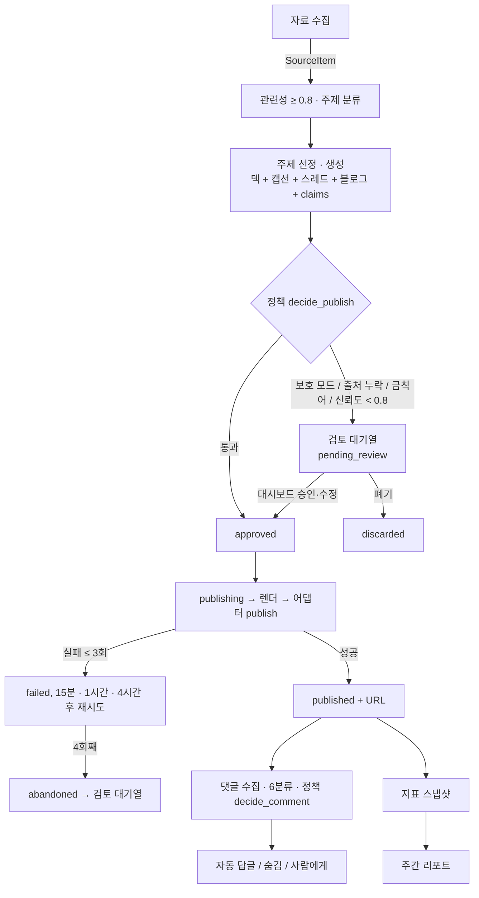
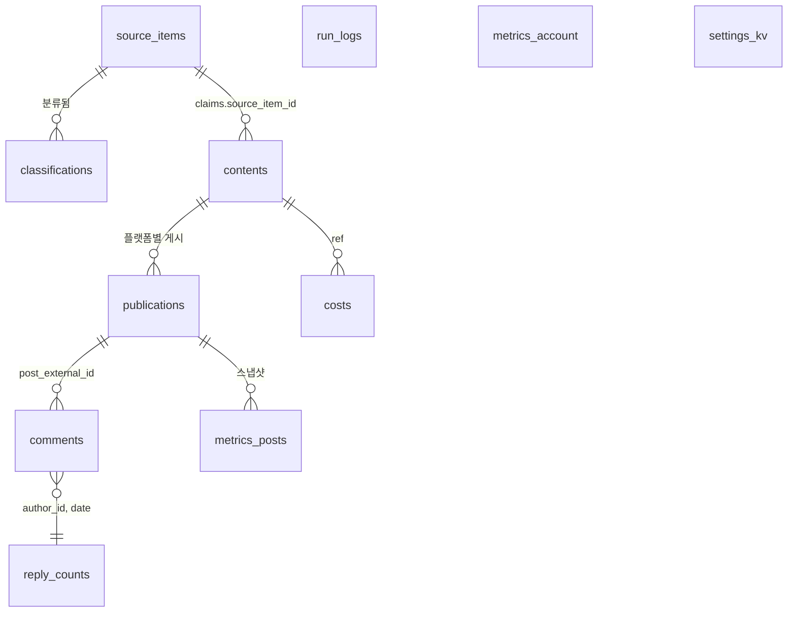

# 현재 구현 아키텍처

> 갱신: 2026-10-16 (C9: 인스타그램 요청 제한(429) 쉬기·댓글 확인 간격, ADR 0038. C10: 작업 요약을 사람이 읽는 문장으로. C11: 실행 기록은 작업 상태 표 + 변화가 있던 실행만, ADR 0040. C12: 안정화(계속 0건 알림, 데이터 백업, 실행 기록 정리, 스케줄러 종료 경합), ADR 0041. C13: 대시보드 간단·고급 모드, ADR 0042. C14: 카드 가상인물 배지는 표지·마지막 장에만, ADR 0043. C15: 키워드로 원고 만들기·수집 제외어, ADR 0044. C16: 올린 이미지를 읽어 자료로, ADR 0045. C17: 캐릭터·로고 그림, ADR 0046). `v0.4-quality`(2026-10-15: S-β 계약 테스트, S-γ 품질 체크리스트·표지 썸네일 가독성, S8 카드 스타일 clean·photo·illust와 설정 화면 견본 선택까지 머지. 세 배치 모두 메인 담당(ADR 0034), 카드 스타일은 ADR 0036 채택, 원고별 스타일은 ADR 0037 제안으로 남음) · 약속은 [contracts.md](contracts.md), 이 문서는 "지금 실제로 어떻게 돌아가는가". 배치마다 맨 아래 구현 상태 표를 갱신한다.

## 1. 한 장 요약

사용자 PC에서 `nsm run` 하나가 세 가지를 동시에 띄운다: 스케줄러(잡 7개), 엔진(포트를 통해 외부 접근), 로컬 대시보드(FastAPI, 127.0.0.1:8765). DB는 DuckDB 파일 하나이고 이 프로세스만 연다.

## 2. 잡과 주기

| 잡 | 주기 | 입력 → 출력 |
|---|---|---|
| health | 30분 | 어댑터 `health()` → 로그아웃 시 알림, 플랫폼 중단 플래그. 요청 제한(429)은 멈추지 않고 쉬기만(ADR 0038) |
| collect | 하루 2회 ±30분 | 소스 → `source_items`(중복 제거) → 관련성·주제 `classifications` |
| generate | 하루 1회 | 주제 선정(14일 중복 제외) → `contents`(draft → pending_review / approved) |
| publish | 게시 슬롯 | approved 1건 → publishing → 렌더 → 어댑터 → published + `publications` |
| reply | 5분 ±1분(설정) | 새 댓글 → 6분류 → 답글 / 숨김 / 에스컬레이션, `reply_counts`. 인스타그램은 30분마다·최근 3일 글만(ADR 0038) |
| metrics | 하루 1회 | 최근 7일 게시물·계정 지표 스냅샷 |
| weekly_report | 주 1회 | 성과 요약·추천 주제 → 대시보드 + md |
| maintenance | 매일 04:30 | 데이터 백업(`backups/data-날짜.duckdb`, 최근 7개, `COPY FROM DATABASE`) + 90일 넘은 실행 기록 정리(C12) |

## 3. 데이터 흐름

콘텐츠 상태: `draft → pending_review → approved → publishing → published | failed → abandoned`, 어디서든 `discarded`. 재시작 시 `publishing` 잔여 건은 `pending_review`로(이중 게시 방지).

## 4. DB 테이블 관계

## 5. 디렉터리 지도

[contracts.md 1절](contracts.md#1-디렉터리와-소유권)이 원본. 핵심만:
`nsm/domain`(모델·정책·상태 머신) → `nsm/ports`(Protocol) ← `nsm/adapters/*`(구현) · `nsm/engine`(잡) · `nsm/store`(DuckDB) · `nsm/app`(대시보드) · `nsm/scheduler` · `nsm/render` + `nsm/templates`(서브).

## 6. 구현 상태

범례: 계획 / 구현 중 / 완료 / 테스트됨(경계 1·2·3 중 어느 것). 배치 PR마다 갱신.

| 모듈 | 상태 | 테스트 | 배치 | 비고 |
|---|---|---|---|---|
| `nsm/cli.py` | 완료 | CLI 테스트 + 수동 | A·C·F·B·S8 | doctor(`--live` 실제 API 확인), init, run, run --once, render-preview(`--style`, 없으면 설정 스타일), install-autostart |
| `nsm/domain/models.py` | 완료 | 단위 | A | 동결. ADR 0009 반영 |
| `nsm/ports/` | 완료 | 단위(fakes 적합성) | A | 동결. `CostSink` 추가 |
| `nsm/store/` (스키마·리포지토리) | 완료 | 단위 | A(스키마), C | `Repository`: 중복 제거, 상태 전이 검사, 게시 재시도 조회, 답글 횟수, 비용 합계, 실행 로그 |
| `nsm/config/` (YAML·keyring·마법사) | 완료 | 단위 | C·S8 | 마법사는 `WizardIO`로 입출력 분리, 키는 환경 변수 → keyring 순. S8: `brand.card_style`(설정 쪽 `BrandSettings`, 도메인 `Brand`는 동결 유지), `image_generation` 기본 `off`, 마법사에서 OpenAI 키를 넣으면 켤지 확인(ADR 0036) |
| `nsm/adapters/sources/` 4종 | 완료 | 단위 + 실사이트 스모크 | D1·Q1 | 업로드·네이버(블로그·뉴스)·구글 트렌드 RSS·커뮤니티. Q1: 텍스트 정리, 관련 글 원문 본문 `fetch_body`(ADR 0022) |
| `nsm/adapters/classifier/` jev·claude | 완료 | 단위(가짜 클라이언트) | D1 | + 키워드 대체(ADR 0011). jev·Claude 실호출은 키 확보 후 확인 필요 |
| `nsm/adapters/generator/` 텍스트·이미지 | 완료 | 단위(가짜 클라이언트) | D2 | Claude(구조화 출력 + fallback), OpenAI 배경. 실호출은 키 확보 후 확인 필요. 네이버 블로그를 게시하지 않으면 블로그 원고 칸을 요청하지 않음(#43, ADR 0026) |
| `nsm/domain/policy.py` | 완료 | 단위 | D1·D2·E | 활동 시간·게시 시간(`should_post`, ADR 0027)·게시 판정·금칙어·배정·템플릿 순환·비용 상한·표기 삽입·댓글 판정 |
| `nsm/domain/labels.py` | 완료 | 단위 | A·B | 표기 문구. 배치 B에서 공정위 예규 원문으로 확정(ADR 0019) |
| 대시보드 화면(`nsm/app/templates`, `static/app.css`, `ko.py`) | 완료 | 라우트(`tests/app`) + 화면 동작(`test_ui.py`) + 전후 스크린샷 | I | 오늘 할 일 중심 개요, 검토 상세 2단, 댓글 카드, 한국어 표시, Pretendard(`/fonts`), 브랜드 강조색, 휴대폰 폭(ADR 0025). 점검 도구 `scripts/dashboard_demo.py`·`dashboard_shots.py` |
| `nsm/app/run_view.py` + 실행 기록(`/logs`) | 완료 | 단위·라우트(`tests/app/test_run_view.py`) + 화면 캡처 | C11 | 작업 상태 표(`job_statuses`, 저장소 `latest_runs`·`last_success_at`), 아무 일 없던 성공 숨김·같은 결과 묶음(`build_rows`), `?all=1` 전체 보기. 오늘 화면 최근 실행도 같은 규칙(ADR 0040) |
| `nsm/render/character.py` + `nsm/app/brand_images.py` + 캐릭터·로고 그림 | 완료 | 렌더(`tests/render/test_character.py`) + 단위(`tests/unit/test_brand_images.py`) + 라우트(`tests/app/test_brand_image_routes.py`) + 브라우저 확인 | C17 | 설정 `brand.character`(parrot·hamster·custom·drawn·none) → `character_art()` → `CharacterArt`를 렌더러 옵션(`get_renderer(character=)`, 스타일처럼 렌더마다 설정에서 읽음)으로. 일러스트형 표지·마지막 장에 ``, `character_ai_made`면 그 장에 `ai-generated` 캡션. 렌더 캐시 지문에 그림 내용 포함(일러스트형만). 기본 캐릭터는 `nsm/templates/characters/`(팀원 그림, 바탕 지운 투명 PNG). 올리기 `POST /settings/brand-image`(Pillow로 테두리에서 이어진 바탕만 지우고 자르기, `<NSM_HOME>/brand/`) (ADR 0046) |
| `nsm/adapters/sources/image_reader.py` + 이미지 자료 | 완료 | 단위(`tests/unit/test_image_reader.py`) + 라우트(`tests/app/test_materials.py`) + 실제 Claude 호출 2회 + 브라우저 확인 | C16 | 올린 png·jpg·webp(5MB 이하, 앞부분으로 형식 확인)를 Claude(`models.classifier`)가 `{has_info, text}`로 옮김. 결과는 `<NSM_HOME>/upload-text/` 캐시(경로·크기·수정 시각)라 올릴 때 한 번만 읽고 자료 모으기는 캐시를 씀. `UploadSource(read_image=)`, `save_material(read_image=)`, `AppState.read_image`(키 없으면 None → 이미지 거절) (ADR 0045) |
| `nsm/engine/keyword.py` + 키워드 원고(`/keyword-draft`) | 완료 | 엔진(`tests/engine/test_keyword.py`) + 라우트(`tests/app/test_keyword_draft.py`) + 브라우저 확인 | C15 | 키워드로 검색 소스(네이버·커뮤니티)만 바로 찾아 판정(키워드를 관심 주제로 더한 지시, 점수는 그 실행에서만 쓰고 DB에 남기지 않음) → 이번에 찾은 안 쓴 관련 자료 3건 → `_make_one`(평소 게시 규칙). 자료가 없으면 만들지 않음. 값 받는 잡 `ARG_JOBS`(`run_job(..., arg=)`, `JobScheduler.run_now(name, arg)`). 수집 제외어 `collect.exclude_words`: 수집 때 저장하지 않고 `_pick_material`에서도 뺌(ADR 0044) |
| 화면 모드(`/ui-mode`, 설정 `ui_mode`) | 완료 | 라우트(`tests/app/test_ui_mode.py`) + 브라우저 확인·캡처(`docs/samples/ui/modes/`) | C13 | 간단(기본)·고급 스위치. 간단은 자료·실행 기록 메뉴, "오늘"의 세부 칸·최근 실행, 설정 세부 값을 숨기고(폼에는 남아 같이 저장) "오늘"에 자료 올리기를 둠. 기능·라우트는 같음(ADR 0042) |
| `nsm/app/settings_form.py` + 설정 화면(`/settings`) | 완료 | 라우트·검사(`tests/app/test_settings.py`) + 예약 다시 걸기(`test_scheduler.py`) | M17 | 페르소나·브랜드·운영 값 편집, 저장 즉시 반영(`set_config`), 활동 시간이 바뀌면 `JobScheduler.reschedule`. 계정·드라이런·키는 제외(ADR 0028) S8: 카드 스타일을 견본 카드(지금 색·페르소나로 그린 표지·본문, `nsm/app/style_preview.py`, `/settings/style-preview/…`)를 보고 고름 |
| `nsm/app/card_editor.py` + 검토 상세 편집 라우트 | 완료 | 라우트(`tests/app/test_card_editor.py`) + 실측 | M16 | 슬라이드별 문구, 배경 올리기·지우기(형식·크기 검사, AI 표기 재계산), 미리보기 렌더(`media/previews`, 잡 스레드, 설정 스타일로). 원고별 스타일 선택은 2차(ADR 0037) |
| `nsm/domain/quality.py` | 완료 | 단위 | Q1 | 품질 규칙: 제외 장르, 카드 목록 번호 떼기, 이모지·딱딱한 표현 검사, 출처 줄(ADR 0023) |
| `nsm/engine/` 잡 8개 | 구현 중 | 경계 1 | D1(collect), D2(generate), E(publish), F(reply·health·metrics), H(weekly_report), C9 | 잡 7개 전부 완료, `runner`가 실행 로그·실패 알림, 재시작 복구. C9: 요청 제한(429) 쉬기(`rate_limit.py`, 쉬는 구간마다 알림 1번), 인스타그램 댓글 확인 간격·기간 따로(`tests/engine/test_rate_limit.py`, ADR 0038). C10: `summary.py`가 결과를 잡별 한국어 문장으로(`JobResult.summary()`, 지금 실행 알림 `ko.result_text`, 로그). DB의 예전 형식 줄은 화면 필터 `run_text`가 문장으로 바꿈(`tests/unit/test_summary.py`). C12: `maintenance` 잡(백업·실행 기록 정리), `watchdog.check_stalls`(health 잡이 30분마다: 계속 0건 → 오늘 할 일·하루 한 번 알림, `tests/engine/test_stability.py`) |
| `nsm/adapters/platforms/dryrun.py` | 완료 | 경계 2(드라이런) + E2E | E | 미리보기 저장, 게시 시각 기준 가짜 댓글·지표, 답글·숨김 로그 |
| `nsm/app/` 대시보드 | 구현 중 | 라우트 테스트 + 실서버 스모크 | F·H(백엔드), I(디자인) | 7개 화면(주간 리포트 포함)·CSRF·Host 검사·직접 답글. 화면은 최소 HTML(디자인은 I) |
| `nsm/scheduler/` + autostart | 완료 | 단위 + 실서버 스모크 | F | 작업 스레드 1개, 활동 시간 기준 트리거, 시작프로그램 폴더(ADR 0013) |
| `nsm/app/materials.py` + 자료 화면(`/materials`) | 완료 | 라우트·파일 검사(`tests/app/test_materials.py`) | M18 | 파일 올리기(형식·크기·읽기 확인, 안전한 이름), 올린 파일 상태, 모은 자료와 판정(ADR 0033) |
| `nsm/adapters/notify/recording.py` + 알림함·게시 대기 화면 | 완료 | 라우트(`tests/app/test_bell_queue.py`) | N2 | 모든 알림을 `notifications` 테이블(스키마 v3)에 남기고 데스크톱으로 넘김, 제목으로 이동 화면 결정. `/queue`: 승인된 원고, 검토로 되돌리기·폐기(ADR 0031) |
| `nsm/adapters/notify/` | 완료 | 단위(`test_notify.py`) + 실측 | F·N1 | Windows 토스트(앱 ID 등록, 이스케이프한 XML을 -EncodedCommand로) + 로그, 같은 제목 60초 내 중복 억제, 설정의 켜기/끄기(ADR 0030) |
| `nsm/render/` + `nsm/templates/` | 완료 | 경계 3(렌더) | S-α·S-γ·S8 | `HtmlCardRenderer`(Jinja2 + Playwright, 전용 스레드), 템플릿 3종, Pretendard 동봉. Playwright 없을 때만 단색 대체. S-γ: 표지 글자를 스레드 썸네일(약 21%) 기준 최소 크기로, 제목 빈 줄 합침(ADR 0035) S8: 스타일 `clean`·`photo`·`illust`(`<body class="style-…">` + `photo.css`·`illust.css` + 코드로 그린 장식·SVG 캐릭터). 렌더러는 렌더할 때마다 설정 스타일을 읽고, 캐시 지문에 스타일 포함(ADR 0036) C14: 이름과 "가상인물" 배지는 표지·마지막 장에만, 중간 장은 둘 다 없음(ADR 0043) |
| `nsm/adapters/drivers/` aside·playwright | 구현 중 | 단위 + 스모크 | D1(수집용 Playwright), B, G1 | 기본값 `aside`(ADR 0017). `aside.py`: repl 실행기·일회용 파일 서버·수집용 `AsideDriver`(G1, ADR 0020). 수집은 Playwright 수집 전용 프로필 유지(ADR 0021) |
| `nsm/adapters/platforms/threads.py` | 완료 | 단위(가짜 실행기) + 실계정 계약(`-m contract`) | G1 | 게시(멱등)·댓글 읽기·답글·숨기기·지표·삭제, 계정 확인. `runtime.make_live_adapters`가 `settings.accounts` 있을 때만 생성 |
| `nsm/adapters/platforms/dryrun.py` | 완료 | 경계 2 + 단위 | D1·S-β | 드라이런 지표는 실계정과 같은 필드만 채움(스레드는 노출수·저장 없음) |
| `nsm/adapters/platforms/instagram.py` | 완료 | 단위(가짜 실행기) + 실계정 계약(`-m contract`) | G2·C9 | 게시(4:5 자르기, Threads 동시 공유 끔, 비율 확인, 멱등)·댓글 읽기·답글·지표·삭제. 숨기기 미지원(ADR 0018). C9: 공통 `aside_common`이 오류 화면을 로그인 풀림과 구분(`nsmCheckPage`), 429면 `RateLimitedError`와 2→4→8시간 쉬기(실제 429 화면으로 확인, ADR 0038) |
| `tests/fakes/`, `tests/conftest.py` | 완료 | - | A | 모든 포트의 가짜 + 픽스처 로더 |
| `tests/engine/` 시나리오 | 완료 | 경계 1 | D1·D2·E·F | 수집·생성·게시·대댓글·상태 점검·지표·드라이런 E2E |
| `tests/contracts/` | 완료 | 경계 2(어댑터 계약) | S-β, G | `test_platform_contract.py`: 드라이런(threads·instagram)으로 게시 → 주소, 댓글(since), 답글, 숨기기(capability 없으면 NotSupportedError), 지표 가용성 매트릭스, health. 실계정은 가짜 실행기로 같은 약속, `-m contract`로 읽기 전용 확인. 게시·삭제까지 하는 실계정 계약은 `test_threads_live.py`·`test_instagram_live.py`. 소유권은 S-β 동안 메인(ADR 0034) |
| `tests/render/` | 완료 | 경계 3 | S-α·S-γ·S8 | PNG 크기·표기 슬롯·광고 배지·AI 캡션·극단 입력·스레드 충돌·표지 썸네일 가독성·제목 빈 줄(S-γ) S8: 스타일 × 템플릿 PNG·넘침, 표기 슬롯 동일, 코드 배경 AI 표기 없음, 글자 HTML·CTA 띠 없음, 세 스타일 썸네일 가독성, 밝은 브랜드 색 대비(`test_card_styles.py`) |
| `tests/app/` | 완료 | 라우트 | F | 승인·폐기·수정·토글·댓글 답글/완료·CSRF·경로 조작 차단 |

## 7. 설계와 구현의 차이

배치 중 계약과 다르게 구현했거나 미뤄 둔 것을 여기 적는다(없으면 "없음").

- 콘텐츠 상태와 플랫폼별 게시 상태를 분리했다(ADR 0009). 계약 초안의 `publishing/failed/abandoned`는 `publications.status`로 옮김.
- 브라우저 드라이버 기본값을 Playwright로 둠(ADR 0010).
- 카드 렌더는 `HtmlCardRenderer`가 한다. `PlaceholderRenderer`(단색 PNG)는 Playwright가 없는 환경의 대체로만 남았다. 렌더는 수집 드라이버와 Playwright가 충돌하지 않도록 전용 스레드에서 한다.
- 분류기는 용도별 묶음(`ClassifierSet`: 관련성·주제·댓글)으로 조립한다. 키워드 대체 구현 때문(ADR 0011).
- 자료의 관련성은 "relevant일 확률"로 통일해 `source_items.relevance`에 저장한다.
- collect 잡은 배치 E가 아니라 D1에서 먼저 만들었다(수집 결과를 실제로 확인하기 위해).
- generate 잡과 게시 판정 정책도 D2에서 먼저 만들었다.
- "최근 14일 주제 제외" 대신 페르소나 주제 순환 + 자료 1회 사용으로 바꿨다(ADR 0012). `topic_cooldown_days`는 아직 안 쓴다.
- DB 스키마 v2: `contents.persona_topic`.
- 같은 플랫폼 게시 사이 최소 간격(`min_hours_between_posts`, 기본 3시간)을 추가했다. 계약 초안의 "활동 시간 내 무작위 시각"은 F의 스케줄러 지터 + 이 간격으로 구현한다.
- 재시작 복구(`recover_interrupted`)는 프로세스가 DB를 열 때마다 실행한다. DuckDB 잠금 때문에 다른 프로세스가 동시에 게시 중일 수 없어서 안전하다.
- 스케줄러는 작업 스레드 1개로 모든 잡을 차례로 돌린다(Playwright 동기 API 스레드 제약). 대시보드의 플랫폼 동작도 `submit()`으로 같은 스레드에서 실행한다.
- 자동 실행은 작업 스케줄러 대신 시작프로그램 폴더(ADR 0013).
- 대시보드 POST는 CSRF 토큰을 검사한다(127.0.0.1 전용이어도 다른 웹사이트가 브라우저를 통해 요청을 보낼 수 있음).
- 댓글 분류 신뢰도 0.6 미만이면 사람에게 넘긴다(계약에 없던 안전장치).
- 주간 리포트는 LLM 없이 규칙으로 계산하고, 기간은 현지 날짜 기준 지난 7일 전체로 고정한다(ADR 0014).
