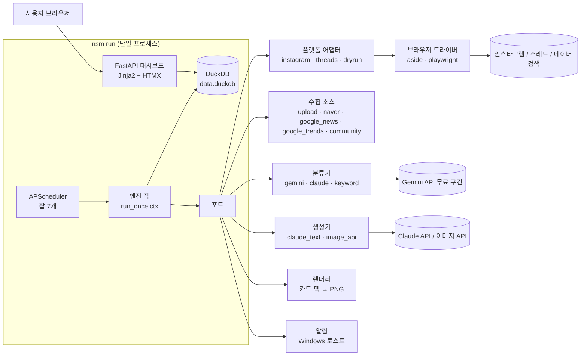
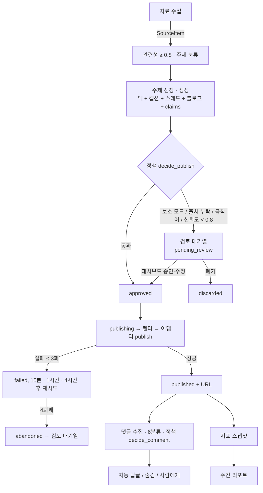
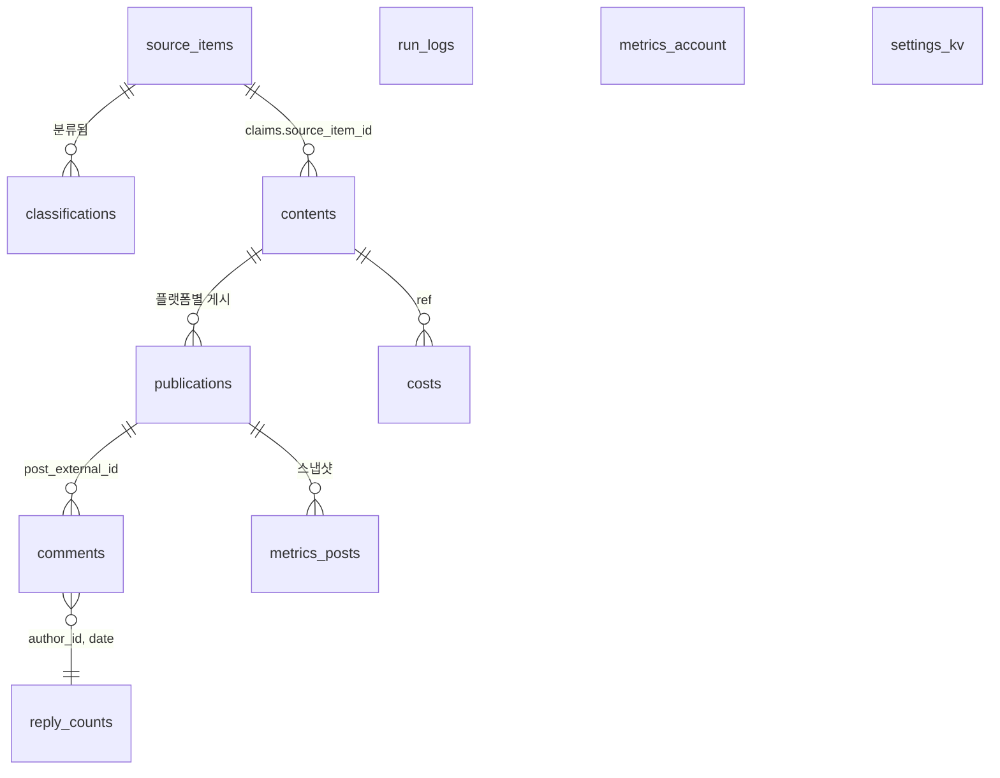

# 현재 구현 아키텍처

> 갱신: 2026-11-13 (R7: 문서 질문의 시간 질문 — 우리 글 댓글 줄 앞에 현지 날짜(`- YYYY-MM-DD 본문 → 답글: …`, 게시 줄과 같은 `_day`), 시간 낱말(`answer.TIME_WORDS`)과 활동 낱말(`ACTIVITY_WORDS`)이 함께 든 질문에는 DB가 만든 최근 활동 조각 `posts/_recent`(`answer.recent_activity`: 최근 게시 10·게시된 글의 최근 댓글 10, 숨김·스팸 제외, 연도 든 기준 시각, 답글은 `sources_db.reply_sent`, 시각은 설정 시간대, 임베딩 없음)을 붙이고 근거 없음이어도 Claude. DB 조각 판정은 경로(`answer.DB_PATHS`), `ask.summary_ids`도 두 경로, 시스템 지시에 시간 순서·자리표시자 두 줄(ADR 0071). R6: 문서 질문 화면 정리 — 순서 질문 칸 → 답 → 최근 질문 → 검색 측정(개발용, `
` 기본 접힘, `eval_notice`면 서버가 open·`#eval`이면 `ask.js`가 펼침), 근거 접힌 줄은 `ask_format.source_title(heading, kind)`(문서: 마지막 절·문서 제목, 수집: 기사 제목, 우리 글: 글 제목·절)과 CSS 말줄임, 펼치면 전체 경로, 최근 질문은 카드(`ask.summary_ids`로 요약 배지), 출처는 라디오 칩·예시 질문 칩(`type=button`, `#ask-q`에 넣기만). 라우트·검색·DB는 그대로(ADR 0070). C44: 인스타그램 인사이트를 원문으로 받아 `instagram.parse_insights`가 이름 기준(뒤 숫자 우선·앞 숫자 대체·한 숫자 한 항목, 두 방향 중 더 많이 채운 쪽)으로 해석, 못 찾으면 None, 조회수 없음·조회한 사람 ≥ 1인데 조회 0은 `ui_changed` 실패+증거, 로딩 중 "0"은 0.5초 두 번 같을 때까지 대기. 성과 읽기 잡이 kv `c44_instagram_reread`로 인스타 최근 90일 글을 한 번 다시 읽음(429·끄는 중이면 다음에 이어서, 실행 기록 "인스타그램 지표 다시 읽기 N/63")(ADR 0069, incidents/0016). R5: 우리 글 근거에 성과 지표 — `Repository.latest_post_metrics`(주간 리포트와 같은 `queries.LATEST_METRICS_CTE`)·`answer._attach_post_context`가 `doc_qa.sources[].metrics`(참여율은 `weekly_report._engagement`), 프롬프트는 `<chunk>` 안 "성과(…)" 줄, 화면은 글 보기 아래 지표 줄. 순위·성과 낱말(`RANK_WORDS`) 질문에는 최근 90일 성과 요약 조각 `posts/_summary`(참여율·조회 상위 10, 임베딩 없음, 배지 "요약")을 더하고 이때는 근거 없음이어도 Claude를 부름(ADR 0068). 색인 본문은 그대로. R4d: 문서 질문 검색을 문서 단위로 묶음 — `search.group_key`(우리 글은 원고 `posts/<content_id>`, 수집·문서는 경로)·`group_hits`, 후보 k의 4배(최소 20) 뒤 묶음마다 `rag.per_doc`(기본 1, 측정으로 고름)자리, `budgeted_search`·`run_eval`이 같은 값. 우리 글 근거에 글 주소 `links`(`Repository.publication_links`, 화면 "스레드 글 보기 · 인스타그램 글 보기"). 복사본 측정에서 질문 1번 정답 4 → 2등, 중복 문서 0, 문서 질문 20개 표 그대로(ADR 0067). R4c: 우리 글 출처의 카드 문구를 플랫폼 문서에서 빼고 원고당 카드 문서 `posts/<content_id>/cards` 하나로(`sources_db._cards_markdown`, 제목·카드 절만이라 조각 글이 예전과 같음), 복사본에서 우리 글 307 → 237조각, 측정 중복이 질문 2·4번 0(ADR 0065 개정 2). R4b: 출처 측정 스크립트 `scripts/rag_measure_sources.py`(질문마다 전체·문서·수집·우리 글 네 번 `search`, 질문 임베딩은 한 번, 정답 순위·출처별 1등 점수·중복 카드 수 표, 표는 순수 함수), 11-10 백업 복사본 전체 색인(3,567조각) 재측정: 같은 원고 두 벌이 상위 5개 중 15/25자리, 카드 문구 원고당 한 번 권고(ADR 0065 개정 1). C43: 스레드·인스타그램 게시 뒤 프로필에서 글을 못 찾으면 성공이 아니라 일시적 실패 "게시를 확인하지 못함"(증거 `publish_unverified`, `AsideAdapterBase._unverified`)으로 재시도, 중복은 게시 전 멱등 확인(6시간 → 72시간)이 막음, 짧은 글만 예전대로, 스레드 글 찾기 90초. 유지보수가 C43 이전 빈 주소 published 줄을 한 번 abandoned로(`repo.abandon_unverified_published_once`). 스레드 성과 읽기는 evaluate 한 번으로 버튼 수를 읽음(ADR 0020 개정 1, incidents/0015). C42: 시제 검사 `quality._dates_in`이 문장 왼쪽부터 기준 연도를 이어받음(날짜의 연도·단독 "YYYY년"·작년/지난해/전년/올해/내년), 가장 늦은 날짜가 오늘 뒤일 때만 미래(ADR 0061 개정 1). C41: 따라잡기 대상에 자료 모으기·원고 만들기(`catch_up.activity_slots`를 트리거와 공유, 하루 2회 모으기는 최근 회차, 시도는 회차 단위, 고정 순서 collect → generate → maintenance → metrics → index → weekly_report, 유예 3시간), 0.4.26 설정 파일의 새 칸 켜기(`catch_up_offered`), 게시 감시는 승인된 원고만 세고 올릴 원고 0개면 이유별 한 줄, 폐기 시·유지보수 때 대기 게시 줄을 abandoned로(ADR 0066 개정 1, incidents/0014). C40: 하루·주 한 번 잡 따라잡기 `nsm/engine/catch_up.py`(예정 시각 표 `fixed_slots`를 트리거와 공유, `due_catch_ups`·`queue_catch_ups`), `JobScheduler.install_catch_up`(켠 뒤 90초·30분마다)·`schedule_once`(1분 간격 DateTrigger), 네 잡 유예 3시간, 실행 기록 접두어 "따라잡기(HH:MM 놓침) · ", 설정 `catch_up_jobs`(ADR 0066, incidents/0013). R4: 문서 질문 출처에 수집 자료 `CollectedSource`·우리 글 `PostsSource`(`nsm/rag/sources_db.py`), 출처 차례 색인과 상한 나눠 쓰기 `nsm/rag/multi.py`, 질문 화면 출처 고르기·배지(ADR 0065). C39: 로그인 표지(`auth_states.json` `logged_in_markers`, `auth_state.looks_logged_in`)가 보이는데 핸들을 못 읽으면 `ui_changed`. health는 성공+`ui_warning`으로 멈추지 않고 health 잡이 6시간에 한 번 기록·알림, `nsmAssertHandle`은 같은 규칙(`ARGS.nsm_auth`)으로 `ui`를 던져 그 건만 실패(ADR 0064). C38: 스레드 `readHandle`이 프로필 아이콘 이름을 svg aria-label과 `<title>` 둘 다로 찾고, 못 찾으면 왼쪽 메뉴의 설정 핸들 링크(글 카드 안 제외)를 마지막 대체로(ADR 0063, incidents/0012). C37: 플랫폼 오류 화면 감지·`nsmEnsure`로 조용한 빈 결과 금지, 댓글 조회 연속 실패 시 30분 쉬기, 스레드 댓글 15분·최근 7일, 느린 확인 기록(ADR 0062, incidents/0011). C36: 날짜 시제를 오늘과 비교하는 프롬프트, 미래 일정을 지난 일로 쓴 문장을 `quality.future_as_past`로 잡아 검토 대기(ADR 0061), 마지막 장 질문 말투. E5: 로그인 안 됨의 세부 상태(로그아웃·본인 확인·문자 인증·두 단계 인증·계정 제한·원인 모름), 상태별 알림·24시간 억제, 멈춘 플랫폼 지표 건너뛰기, 빈 화면은 일시적(ADR 0060, incidents/0010). R3d: 검색 측정에서 질문이 원문으로 실린 유출 조각 제외(ADR 0057 개정 1). R3c: 문서 질문 POST 뒤 리다이렉트·기록 보기·지우기·보관 정리·초/원화·백틱 코드·[n] 링크(ADR 0058 개정 1). R3b: Gemini 임베딩 분당 한도를 직전 1분 보낸 건수로 지켜 질문이 61초 기다리지 않게. R3: 문서 질문 탭 `/ask`·답변 `nsm/rag/answer.py`·측정 `nsm/rag/evaluate.py`·`doc_qa`·`doc_eval`(ADR 0058). R2: 문서 검색 `nsm/rag/search.py`·`nsm ask`, 색인 잡 `index`(매일 20:00, ADR 0057). R1: 문서 조각·임베딩 색인 `nsm/rag/`·`doc_chunks`·`nsm index`(ADR 0056). C35: 설정 화면 API 키 칸·키 확인·재시작 없는 반영(ADR 0028 개정 1). E4: health 끄는 중 멈춤 없음·일시적 실패는 연속 2회에 멈춤·멈춤 이유 저장(ADR 0054 개정 1). E3: 장애 기록 `docs/incidents/`. E2: 장애 화면·failures 표·자동 진단(ADR 0055). E1: 오류 종류 표·실패 증거(ADR 0054). C34: 같은 소식 기준 강화·판정 캐시에 비교 기준 기록·오늘 쓴 주제 뒤로·관련성 '글의 중심'. C33: 중단 표시·자료 정리·해시태그 상한·짧은 표기(ADR 0053). C32: 댓글 2차 판정·스팸 자동 처리(ADR 0052). C31: 원고 품질 하한·같은 소식 제외·소재 상한(ADR 0051). C30: 구글 뉴스 RSS 소스(ADR 0050). C29: 프리셋(작업 공간, DB 분리, ADR 0049). C28: "오늘" 화면 비율·다음 게시 줄바꿈. C27: 분류기 Gemini 무료 구간·jev 제거(ADR 0048). C9: 인스타그램 요청 제한(429) 쉬기·댓글 확인 간격, ADR 0038. C10: 작업 요약을 사람이 읽는 문장으로. C11: 실행 기록은 작업 상태 표 + 변화가 있던 실행만, ADR 0040. C12: 안정화(계속 0건 알림, 데이터 백업, 실행 기록 정리, 스케줄러 종료 경합), ADR 0041. C13: 대시보드 간단·고급 모드, ADR 0042. C14: 카드 가상인물 배지는 표지·마지막 장에만, ADR 0043. C15: 키워드로 원고 만들기·수집 제외어, ADR 0044. C16: 올린 이미지를 읽어 자료로, ADR 0045. C17: 캐릭터·로고 그림, ADR 0046. C18: 댓글 답글이 원고에 쓴 자료까지 봄, ADR 0047. C19: 캐릭터 AI 표기 기본 끔. C20: 동봉 캐릭터 빼고 기본 "없음", 카드 캐릭터 260px. C21~C25: 인스타그램 화면 변경·답글 스레드·확인 안 된 답글·실패 상황 검증. C26: 버전 표시·다음 게시 시각). `v0.4-quality`(2026-10-15: S-β 계약 테스트, S-γ 품질 체크리스트·표지 썸네일 가독성, S8 카드 스타일 clean·photo·illust와 설정 화면 견본 선택까지 머지. 세 배치 모두 메인 담당(ADR 0034), 카드 스타일은 ADR 0036 채택, 원고별 스타일은 ADR 0037 제안으로 남음) · 약속은 [contracts.md](contracts.md), 이 문서는 "지금 실제로 어떻게 돌아가는가". 배치마다 맨 아래 구현 상태 표를 갱신한다.

## 1. 한 장 요약

사용자 PC에서 `nsm run` 하나가 세 가지를 동시에 띄운다: 스케줄러(잡 7개), 엔진(포트를 통해 외부 접근), 로컬 대시보드(FastAPI, 127.0.0.1:8765). DB는 DuckDB 파일 하나이고 이 프로세스만 연다.

## 2. 잡과 주기

| 잡 | 주기 | 입력 → 출력 |
|---|---|---|
| health | 30분 | 어댑터 `health()` → 로그아웃 시 알림, 플랫폼 중단 플래그. 요청 제한(429)은 멈추지 않고 쉬기만(ADR 0038) |
| collect | 하루 2회 ±30분 | 소스 → `source_items`(중복 제거) → 관련성·주제 `classifications` |
| generate | 하루 1회 | 주제 선정(14일 중복 제외) → `contents`(draft → pending_review / approved) |
| publish | 게시 슬롯 | approved 1건 → publishing → 렌더 → 어댑터 → published + `publications` |
| reply | 5분 ±1분(설정) | 새 댓글 → 6분류 → 답글 / 숨김 / 에스컬레이션, `reply_counts`. 답글을 보냈지만 어댑터가 확인 못 하면(빈 ID) 재시도 없이 에스컬레이션(C23). 보내기 전 'replying'으로 적고 켤 때 남은 'replying'은 에스컬레이션(`recover_interrupted_replies`, C24). 인스타그램은 30분마다·최근 3일 글만(ADR 0038). 답글 근거는 게시물 본문 + 그 원고에 쓴 자료 최대 3개(`repo.sources_for_content`, C18, ADR 0047) |
| metrics | 하루 1회 | 최근 7일 게시물·계정 지표 스냅샷(C44 뒤 첫 실행만 인스타 최근 90일 글 한 번 다시 읽기) |
| weekly_report | 주 1회 | 성과 요약·추천 주제 → 대시보드 + md |
| maintenance | 매일 04:30 | 데이터 백업(`backups/data-날짜.duckdb`, 최근 7개, `COPY FROM DATABASE`) + 90일 넘은 실행 기록 정리(C12). C41: 폐기 원고의 대기 게시 줄 정리. C43: 빈 주소 published 줄을 한 번만 abandoned로 |
| catch_up | 켠 뒤 90초, 30분 | 오늘 예정 시각(지터+5분)이 지났는데 예정 1시간 전 이후 끝난 실행(종료 중단 제외)이 없는 `settings.catch_up_jobs`(C41부터 collect·generate·maintenance·metrics·index·weekly_report, 이 순서 고정, 모으기는 가장 최근 회차, 페르소나 꺼짐이면 모으기·만들기 제외)를 1분 간격 일회성 예약으로 한 번. 오늘 시도는 `settings_kv.catch_up_tried`(현지 날짜·기동 id). 돌기 직전에 끄는 중·그새 돌았음을 다시 봄. 네 잡의 CronTrigger 유예는 3시간, 나머지는 15분(C40, ADR 0066) |

## 3. 데이터 흐름

콘텐츠 상태: `draft → pending_review → approved → publishing → published | failed → abandoned`, 어디서든 `discarded`. 재시작 시 `publishing` 잔여 건은 `pending_review`로(이중 게시 방지).

## 4. DB 테이블 관계

## 5. 디렉터리 지도

[contracts.md 1절](contracts.md#1-디렉터리와-소유권)이 원본. 핵심만:
`nsm/domain`(모델·정책·상태 머신) → `nsm/ports`(Protocol) ← `nsm/adapters/*`(구현) · `nsm/engine`(잡) · `nsm/store`(DuckDB) · `nsm/app`(대시보드) · `nsm/scheduler` · `nsm/render` + `nsm/templates`(서브).

## 6. 구현 상태

범례: 계획 / 구현 중 / 완료 / 테스트됨(경계 1·2·3 중 어느 것). 배치 PR마다 갱신.

| 모듈 | 상태 | 테스트 | 배치 | 비고 |
|---|---|---|---|---|
| `nsm/cli.py` | 완료 | CLI 테스트 + 수동 | A·C·F·B·S8 | doctor(`--live` 실제 API 확인), init, run, run --once, render-preview(`--style`, 없으면 설정 스타일), install-autostart |
| `nsm/domain/models.py` | 완료 | 단위 | A | 동결. ADR 0009 반영 |
| `nsm/ports/` | 완료 | 단위(fakes 적합성) | A | 동결. `CostSink` 추가 |
| `nsm/store/` (스키마·리포지토리) | 완료 | 단위 | A(스키마), C | `Repository`: 중복 제거, 상태 전이 검사, 게시 재시도 조회, 답글 횟수, 비용 합계, 실행 로그 |
| `nsm/config/` (YAML·keyring·마법사) | 완료 | 단위 | C·S8 | 마법사는 `WizardIO`로 입출력 분리, 키는 환경 변수 → keyring 순. S8: `brand.card_style`(설정 쪽 `BrandSettings`, 도메인 `Brand`는 동결 유지), `image_generation` 기본 `off`, 마법사에서 OpenAI 키를 넣으면 켤지 확인(ADR 0036) |
| `nsm/adapters/sources/` 5종 | 완료 | 단위 + 실사이트 스모크 | D1·Q1·C30 | 업로드·네이버(블로그·뉴스)·구글 뉴스 RSS(C30, 주제별 기사, 원문은 관련 자료만 주소 풀어 읽음)·구글 트렌드 RSS·커뮤니티. Q1: 텍스트 정리, 관련 글 원문 본문 `fetch_body`(ADR 0022) |
| `nsm/adapters/classifier/` gemini·claude·keyword | 완료 | 단위(가짜 HTTP·클라이언트) + 운영 자료 294건 비교 | D1·C27 | Gemini 무료 구간(10건 묶음, 429 대기)이 기본, `FallbackClassifier`가 실패 시 Claude → 낱말 규칙으로 넘기며 알림. jev(MotherDuck)는 체험 종료로 제거(ADR 0048) |
| `nsm/adapters/generator/` 텍스트·이미지 | 완료 | 단위(가짜 클라이언트) | D2 | Claude(구조화 출력 + fallback), OpenAI 배경. 실호출은 키 확보 후 확인 필요. 네이버 블로그를 게시하지 않으면 블로그 원고 칸을 요청하지 않음(#43, ADR 0026) |
| `nsm/domain/policy.py` | 완료 | 단위 | D1·D2·E | 활동 시간·게시 시간(`should_post`, ADR 0027)·게시 판정·금칙어·배정·템플릿 순환·비용 상한·표기 삽입·댓글 판정 |
| `nsm/domain/labels.py` | 완료 | 단위 | A·B | 표기 문구. 배치 B에서 공정위 예규 원문으로 확정(ADR 0019) |
| `nsm/app/next_publish.py` + 버전 표시 | 완료 | 단위(`tests/unit/test_next_publish.py`) + 라우트(`tests/app/test_dashboard.py`) | C26 | 승인된 원고가 있을 때 플랫폼별 다음 게시 시각(대기/재시도 시각 → 요청 제한 → 같은 플랫폼 간격 → 하루 한도 → 게시 시간 `policy.next_window_start`). 바닥글 `app_version()`은 설치 정보에서 읽어 "지금 켜진 버전"을 보여 줌 |
| 대시보드 화면(`nsm/app/templates`, `static/app.css`, `ko.py`) | 완료 | 라우트(`tests/app`) + 화면 동작(`test_ui.py`) + 전후 스크린샷 | I | 오늘 할 일 중심 개요, 검토 상세 2단, 댓글 카드, 한국어 표시, Pretendard(`/fonts`), 브랜드 강조색, 휴대폰 폭(ADR 0025), 어절 단위 줄바꿈(`keep-all`)·개요 두 칸 1.25:1(C28), 설정 맨 위 프리셋 칸·상단 프리셋 배지(C29). 점검 도구 `scripts/dashboard_demo.py`·`dashboard_shots.py` |
| `nsm/app/run_view.py` + 실행 기록(`/logs`) | 완료 | 단위·라우트(`tests/app/test_run_view.py`) + 화면 캡처 | C11 | 작업 상태 표(`job_statuses`, 저장소 `latest_runs`·`last_success_at`), 아무 일 없던 성공 숨김·같은 결과 묶음(`build_rows`), `?all=1` 전체 보기. 오늘 화면 최근 실행도 같은 규칙(ADR 0040) |
| `nsm/render/character.py` + `nsm/app/brand_images.py` + 캐릭터·로고 그림 | 완료 | 렌더(`tests/render/test_character.py`) + 단위(`tests/unit/test_brand_images.py`) + 라우트(`tests/app/test_brand_image_routes.py`) + 브라우저 확인 | C17 | 설정 `brand.character`(none 기본·custom·drawn, C20) → `character_art()` → `CharacterArt`를 렌더러 옵션(`get_renderer(character=)`, 스타일처럼 렌더마다 설정에서 읽음)으로. 일러스트형 표지·마지막 장에 ``, `character_ai_made`(기본 끔, C19)면 그 장에 `ai-generated` 캡션. 렌더 캐시 지문에 그림 내용 포함(일러스트형만). 동봉 캐릭터 없음(C20에서 뺌). 올리기 `POST /settings/brand-image`(Pillow로 테두리에서 이어진 바탕만 지우고 자르기, `<NSM_HOME>/brand/`) (ADR 0046) |
| `nsm/adapters/sources/image_reader.py` + 이미지 자료 | 완료 | 단위(`tests/unit/test_image_reader.py`) + 라우트(`tests/app/test_materials.py`) + 실제 Claude 호출 2회 + 브라우저 확인 | C16 | 올린 png·jpg·webp(5MB 이하, 앞부분으로 형식 확인)를 Claude(`models.classifier`)가 `{has_info, text}`로 옮김. 결과는 `<NSM_HOME>/upload-text/` 캐시(경로·크기·수정 시각)라 올릴 때 한 번만 읽고 자료 모으기는 캐시를 씀. `UploadSource(read_image=)`, `save_material(read_image=)`, `AppState.read_image`(키 없으면 None → 이미지 거절) (ADR 0045) |
| `nsm/engine/keyword.py` + 키워드 원고(`/keyword-draft`) | 완료 | 엔진(`tests/engine/test_keyword.py`) + 라우트(`tests/app/test_keyword_draft.py`) + 브라우저 확인 | C15 | 키워드로 검색 소스(네이버·커뮤니티)만 바로 찾아 판정(키워드를 관심 주제로 더한 지시, 점수는 그 실행에서만 쓰고 DB에 남기지 않음) → 이번에 찾은 안 쓴 관련 자료 3건 → `_make_one`(평소 게시 규칙). 자료가 없으면 만들지 않음. 값 받는 잡 `ARG_JOBS`(`run_job(..., arg=)`, `JobScheduler.run_now(name, arg)`). 수집 제외어 `collect.exclude_words`: 수집 때 저장하지 않고 `_pick_material`에서도 뺌(ADR 0044) |
| 화면 모드(`/ui-mode`, 설정 `ui_mode`) | 완료 | 라우트(`tests/app/test_ui_mode.py`) + 브라우저 확인·캡처(`docs/samples/ui/modes/`) | C13 | 간단(기본)·고급 스위치. 간단은 자료·실행 기록 메뉴, "오늘"의 세부 칸·최근 실행, 설정 세부 값을 숨기고(폼에는 남아 같이 저장) "오늘"에 자료 올리기를 둠. 기능·라우트는 같음(ADR 0042) |
| `nsm/app/settings_form.py` + 설정 화면(`/settings`) | 완료 | 라우트·검사(`tests/app/test_settings.py`) + 예약 다시 걸기(`test_scheduler.py`) | M17 | 페르소나·브랜드·운영 값 편집, 저장 즉시 반영(`set_config`), 활동 시간이 바뀌면 `JobScheduler.reschedule`. 계정·드라이런·키는 제외(ADR 0028) S8: 카드 스타일을 견본 카드(지금 색·페르소나로 그린 표지·본문, `nsm/app/style_preview.py`, `/settings/style-preview/…`)를 보고 고름 |
| `nsm/app/card_editor.py` + 검토 상세 편집 라우트 | 완료 | 라우트(`tests/app/test_card_editor.py`) + 실측 | M16 | 슬라이드별 문구, 배경 올리기·지우기(형식·크기 검사, AI 표기 재계산), 미리보기 렌더(`media/previews`, 잡 스레드, 설정 스타일로). 원고별 스타일 선택은 2차(ADR 0037) |
| `nsm/domain/quality.py` | 완료 | 단위 | Q1, C36, C42 | 품질 규칙: 제외 장르, 카드 목록 번호 떼기, 이모지·딱딱한 표현 검사, 미래 일정 시제 검사(C36, 오늘 날짜는 generate가 넘김. C42: 같은 문장 안 연도 이어받기), 출처 줄(ADR 0023) |
| `nsm/engine/` 잡 8개 + `material.py`(재료 고르기, C31) | 구현 중 | 경계 1 | D1(collect), D2(generate), E(publish), F(reply·health·metrics), H(weekly_report), C9 | 잡 7개 전부 완료, `runner`가 실행 로그·실패 알림, 재시작 복구. C9: 요청 제한(429) 쉬기(`rate_limit.py`, 쉬는 구간마다 알림 1번), 인스타그램 댓글 확인 간격·기간 따로(`tests/engine/test_rate_limit.py`, ADR 0038). C10: `summary.py`가 결과를 잡별 한국어 문장으로(`JobResult.summary()`, 지금 실행 알림 `ko.result_text`, 로그). DB의 예전 형식 줄은 화면 필터 `run_text`가 문장으로 바꿈(`tests/unit/test_summary.py`). C12: `maintenance` 잡(백업·실행 기록 정리), `watchdog.check_stalls`(health 잡이 30분마다: 계속 0건 → 오늘 할 일·하루 한 번 알림, `tests/engine/test_stability.py`) |
| `nsm/adapters/platforms/dryrun.py` | 완료 | 경계 2(드라이런) + E2E | E | 미리보기 저장, 게시 시각 기준 가짜 댓글·지표, 답글·숨김 로그 |
| `nsm/app/` 대시보드 | 구현 중 | 라우트 테스트 + 실서버 스모크 | F·H(백엔드), I(디자인) | 7개 화면(주간 리포트 포함)·CSRF·Host 검사·직접 답글. 화면은 최소 HTML(디자인은 I) |
| `nsm/scheduler/` + autostart | 완료 | 단위 + 실서버 스모크 | F | 작업 스레드 1개, 활동 시간 기준 트리거, 시작프로그램 폴더(ADR 0013) |
| `nsm/engine/catch_up.py`, `JobScheduler.install_catch_up`·`schedule_once`, 설정 `catch_up_jobs` | 완료 | 단위·스케줄러·라우트(예정 전·지터 안, 대상만, 1시간 창·중단·끝나지 않은 실행, 주간 월 08:00, 하루 한 번·다음 기동, 끄는 중, 1분 간격, 빈 목록·설정 폼, 유예 3시간/15분, 접두어·중단 접두어, "오늘 따라잡은 일") | C40 | 놓친 하루·주 한 번 잡 따라잡기(ADR 0066, incidents/0013) |
| `catch_up.activity_slots`·회차 단위 시도, `repo.waiting_publications`(승인된 원고만)·`abandon_publications`·`abandon_discarded_leftovers`, `watchdog._no_drafts` | 완료 | 단위·잡·라우트(모으기·만들기 시각=트리거, 고정 순서·1분, 최근 회차·저녁 회차, 페르소나 꺼짐, 오늘 목표면 새 원고 없음, 칸 여섯·예전 설정 파일, 폐기·검토 대기 줄 안 셈, 원인별 문구·새 설치 무알림·한 줄, 폐기 시 abandoned, 유지보수 정리) | C41 | 수집·생성 따라잡기와 게시 감시 오보 고침(ADR 0066 개정 1, incidents/0014) |
| `nsm/app/materials.py` + 자료 화면(`/materials`) | 완료 | 라우트·파일 검사(`tests/app/test_materials.py`) | M18 | 파일 올리기(형식·크기·읽기 확인, 안전한 이름), 올린 파일 상태, 모은 자료와 판정(ADR 0033) |
| `nsm/adapters/notify/recording.py` + 알림함·게시 대기 화면 | 완료 | 라우트(`tests/app/test_bell_queue.py`) | N2 | 모든 알림을 `notifications` 테이블(스키마 v3)에 남기고 데스크톱으로 넘김, 제목으로 이동 화면 결정. `/queue`: 승인된 원고, 검토로 되돌리기·폐기(ADR 0031) |
| `nsm/adapters/notify/` | 완료 | 단위(`test_notify.py`) + 실측 | F·N1 | Windows 토스트(앱 ID 등록, 이스케이프한 XML을 -EncodedCommand로) + 로그, 같은 제목 60초 내 중복 억제, 설정의 켜기/끄기(ADR 0030) |
| `nsm/render/` + `nsm/templates/` | 완료 | 경계 3(렌더) | S-α·S-γ·S8 | `HtmlCardRenderer`(Jinja2 + Playwright, 전용 스레드), 템플릿 3종, Pretendard 동봉. Playwright 없을 때만 단색 대체. S-γ: 표지 글자를 스레드 썸네일(약 21%) 기준 최소 크기로, 제목 빈 줄 합침(ADR 0035) S8: 스타일 `clean`·`photo`·`illust`(`<body class="style-…">` + `photo.css`·`illust.css` + 코드로 그린 장식·SVG 캐릭터). 렌더러는 렌더할 때마다 설정 스타일을 읽고, 캐시 지문에 스타일 포함(ADR 0036) C14: 이름과 "가상인물" 배지는 표지·마지막 장에만, 중간 장은 둘 다 없음(ADR 0043) |
| `nsm/adapters/drivers/` aside·playwright | 구현 중 | 단위 + 스모크 | D1(수집용 Playwright), B, G1 | 기본값 `aside`(ADR 0017). `aside.py`: repl 실행기·일회용 파일 서버·수집용 `AsideDriver`(G1, ADR 0020). 수집은 Playwright 수집 전용 프로필 유지(ADR 0021) |
| `nsm/adapters/platforms/threads.py` | 완료 | 단위(가짜 실행기) + 실계정 계약(`-m contract`) | G1 | 게시(멱등)·댓글 읽기·답글·숨기기·지표·삭제, 계정 확인. `runtime.make_live_adapters`가 `settings.accounts` 있을 때만 생성. C38: 계정 확인은 프로필 아이콘 aria-label·`<title>` 둘 다, 마지막 대체는 왼쪽 메뉴의 설정 핸들 링크(ADR 0063). C43: 게시 뒤 글을 못 찾으면 일시적 실패(재시도는 멱등 확인부터), 글 찾기 90초, 지표는 evaluate 한 번으로 |
| `nsm/adapters/platforms/dryrun.py` | 완료 | 경계 2 + 단위 | D1·S-β | 드라이런 지표는 실계정과 같은 필드만 채움(스레드는 노출수·저장 없음) |
| `nsm/adapters/platforms/instagram.py` | 완료 | 단위(가짜 실행기) + 실계정 계약(`-m contract`) | G2·C9 | 게시(4:5 자르기, Threads 동시 공유 끔, 비율 확인, 멱등. C21: "알림 설정" 안내 창은 `nsmDismissPrompts`로 닫고 대화상자가 여럿이면 모두 찾음. C22: 답글은 "답글 달기" 뒤 입력창을 다시 클릭하지 않아야 댓글 아래에 달림. C25: 전송은 Enter(마우스 클릭은 초점을 빼앗아 답글 대상이 지워지는 경쟁이 있었음), 안 먹으면 "게시")·댓글 읽기·답글·지표·삭제. 숨기기 미지원(ADR 0018). C9: 공통 `aside_common`이 오류 화면을 로그인 풀림과 구분(`nsmCheckPage`), 429면 `RateLimitedError`와 2→4→8시간 쉬기(실제 429 화면으로 확인, ADR 0038). C43: 게시 뒤 글을 못 찾으면 일시적 실패(재시도는 멱등 확인부터) |
| `tests/fakes/`, `tests/conftest.py` | 완료 | - | A | 모든 포트의 가짜 + 픽스처 로더 |
| `tests/engine/` 시나리오 | 완료 | 경계 1 | D1·D2·E·F | 수집·생성·게시·대댓글·상태 점검·지표·드라이런 E2E |
| `nsm/domain/errors.py`, `nsm/adapters/evidence.py` | 완료 | 단위(5종 정책·증거·정리·비밀 지우기) | E1 | 오류 종류 표와 실패 증거(6-1절, ADR 0054). 정리는 maintenance 잡(`evidence_keep_days`) |
| `nsm/engine/incidents.py`, `nsm/adapters/diagnosis.py`, `nsm/app/incidents.py` | 완료 | 단위(기록·진단 상한·비용·경계) + 라우트 | E2 | 실패 기록·자동 진단·장애 화면(6-2절, ADR 0055). `failures` 표(스키마 v5) |
| `nsm/adapters/platforms/auth_state.py`, `data/auth_states.json`, `AsideAdapterBase._health` | 완료 | 단위(실제 증거 4건·주소/문구 조합·빈 화면·로그인 폼·포트 미변경·health 스크립트가 홈만 엶) | E5·C39 | 로그인 세부 상태(ADR 0060). C39: 로그인 표지 `logged_in_markers`·`looks_logged_in`·`js_auth_args`, 핸들 못 읽음 + 표지면 health 성공 + `ui_warning`(멈춤 없음, health 잡이 6시간에 한 번 `ui_changed` 기록·알림), `nsmAssertHandle`은 `ui`(ADR 0064). 테스트: 실제 증거 5건(로그인된 스레드 1건 포함), 가짜 탭, health 잡 |
| `aside_common.nsmCheckPage`·`nsmEnsure`, `nsm/engine/reply.py` 연속 실패 쉬기·느린 확인 | 완료 | 단위(node 가짜 실행기: 오류 화면·본문 시간 초과·댓글 0개·문법) + 엔진(쉬기·알림 1회·초기화·설정·느린 확인) | C37 | 조용한 빈 결과 금지(ADR 0062, incidents/0011) |
| `nsm/engine/pause.py`, `nsm/engine/health_metrics.run_health` | 완료 | 단위(끄는 중·연속 실패·로그인 즉시·이유 저장·예전 플래그) + 라우트 | E4 | health 멈춤 기준과 이유 저장(6-2절, ADR 0054 개정 1, incidents/0008) |
| `docs/incidents/` | 완료 | - | E3 | 운영 장애 기록 9건과 템플릿(문서) |
| `nsm/app/keys.py`, `nsm/runtime.refresh_secret_parts` | 완료 | 라우트(등록·덮어쓰기·삭제·CSRF·형식·환경 변수·값 미노출) + 키 확인 7가지 응답 + 재생성 | C35 | 설정 화면 API 키 칸. keyring에만 저장, 모델 목록 조회로 확인(비용 0), 저장 뒤 키를 쓰는 부품만 작업 스레드에서 재생성(ADR 0028 개정 1) |
| `nsm/rag/`(chunker·sources·gemini·indexer·command), `nsm index` | 완료 | 단위(조각 규칙·증분·삭제·제외·키 없음·왕복·가짜 HTTP·실제 잠금) | R1 | 문서 조각·임베딩 색인(6-3절, ADR 0056). 검색·화면은 R2·R3 |
| `nsm/rag/search.py`, `nsm/engine/doc_index.py`, `nsm ask` | 완료 | 단위(순위·k·기준값·벡터 없음·비용, 잡 상한·키 없음·한도·실행 기록·비용 상한, 화면 줄, ask 출력, 질문 파일) | R2 | 문서 검색과 색인 잡(6-3절, ADR 0057). 답 만들기·챗봇 화면은 R3 |
| `nsm/rag/answer.py`, `nsm/rag/evaluate.py`, `nsm/app/ask.py` | 완료 | 라우트·단위(근거 없음이면 Claude 0번, 인용, 경계, CSRF, 길이, 하루 상한, 비용, 기록, 이스케이프, 측정·Claude 안 부름, 빈 답·잘림·생각 끄기) | R3 | 문서 질문 화면(6-4절, ADR 0058) |
| `nsm/app/ask_format.py`, `nsm/app/static/ask.js`, `nsm/rag/answer.prune_qa` | 완료 | 라우트·단위(303·새로고침 비용 없음·상세·지우기·CSRF·보관 정리·초·원화·백틱·이스케이프·[n]·안내 코드) | R3c | 문서 질문 손질(ADR 0058 개정 1) |
| `Repository.latest_post_metrics`, `answer._attach_post_context`·`metrics_note`·`wants_summary`·`performance_summary`, `ask_format.post_metrics` | 완료 | 단위·라우트(최신 1행, 미게시·외부 id 없음·지표 없음 제외, saves NULL, 참여율 None, 성과 줄은 `<docs>` 안만·이스케이프, 순위 낱말 있음·없음·다른 출처, 요약 상위 10·겹침 한 번·90일 밖 제외·지표 없으면 없음, 근거 없음+요약만으로 Claude, 낱말 없으면 안 부름, 예전 기록 metrics 없음, 화면 지표 줄·저장은 인스타만·요약 배지) | R5 | 우리 글 근거의 성과 지표와 순위 질문의 성과 요약(ADR 0068) |
| `ask_format.source_title`, `ask.summary_ids`, `ask.html`·`ask.js`·`app.css`(문서 질문 부분) | 완료 | 단위·라우트(제목 규칙: 문서·예전 기록·수집·우리 글·카드·댓글·요약·빈 값·60자 초과 안 자름, 화면 순서, 모델명은 title만, 측정 접힘·안내 있으면 open, 최근 질문 카드·미리보기·근거 없음 문구·요약 배지, 예시 칩 4개 type=button, 출처 라디오 4개·전체 기본, 템플릿에 측정 질문 원문 없음) | R6 | 문서 질문 화면 정리(ADR 0070) |
| `answer.wants_recent`·`recent_activity`·`TIME_WORDS`·`DB_PATHS`, `sources_db.reply_sent`, 댓글 줄 날짜(`PostsSource`) | 완료 | 단위(댓글 줄 날짜·시간대로 날짜 넘어감·날짜 없으면 예전 형식, 시간 낱말 있음·없음·시간 낱말만 있는 문서 질문·docs/collected면 안 붙음, 최신 순·서울 시각·기준 시각 연도·숨김/스팸 제외·보내지 못한 답글은 없음·이름 지움·120자·10건·지운/실패한 글의 댓글 제외, 글도 댓글도 없으면 없음, 근거 없음+최근 활동만으로 Claude, 성과 요약과 같이 붙으면 둘 다 score null·summary true, doc_chunks에 없음, `summary_ids`가 두 경로, 시스템 지시 두 줄) | R7 | 시간 질문에 최근 활동 조각(ADR 0071) |
| `instagram.parse_insights`·`ig_number`, `_POST_METRICS` 원문·안정 대기, `health_metrics` 한 번 다시 읽기(`REREAD_KEY`) | 완료 | 단위·잡(실제 화면 글, 예전 순서, 한 줄 쌍, 천·만·K·M, 없음 → None, 한 숫자 한 항목, 이름 전체 일치, 비율 제외, 조회 None·조회한 사람 ≥ 1에 조회 0 → `ui_changed`+증거, 90일 한 번·120일 밖·스레드 제외, 429 뒤 이어서, 실패는 0 저장 안 함, 요약 문장) | C44 | 인스타그램 인사이트 이름 기준 해석과 불가능한 0 실패, 옛 글 한 번 다시 읽기(ADR 0069, incidents/0016) |
| `nsm/rag/search.group_key`·`group_hits`(`rag.per_doc`), `Repository.publication_links`, 근거 글 보기 링크(`ask_format.post_links`) | 완료 | 단위·라우트(세 출처의 묶음 키, per_doc 1·2 자리 채우기, 점수 순서, 후보 부족, 기준값은 묶은 뒤, cards·threads 한 묶음, 넉넉한 후보, 설정 범위, 게시됨·주소 있는 것만, 질문당 조회 한 번, 예전 기록 links 없음, http 아닌 주소 안 보임) | R4d | 같은 원고·기사·파일은 상위 k에 한 자리(ADR 0067) |
| `nsm/rag/sources_db.py`, `nsm/rag/multi.py`, 출처 고르기(`/ask`), `nsm index --source`, 측정 `scripts/rag_measure_sources.py`(R4b) | 완료 | 단위·잡·라우트(관련성·기간·빈 본문 거르기, 제목 경로·마크다운, 게시된 글만·작성자 없음·숨긴 댓글, 기간 밖 삭제, 세 출처 순서·상한 나눠 쓰기·한 출처 실패·429, CLI, 출처 전달·배지·출처별 수·예전 기록, R4b 측정 표의 정답 순위·kind=any·중복 카드·질문 문장 없음·질문당 한 번 임베딩, R4c 카드 문서 원고당 하나·한 플랫폼만·deck 없음·미게시·제목 경로·댓글 안 섞임·cards는 중복 아님) | R4·R4b·R4c | 수집 자료·우리 글 출처(6-3·6-4절, ADR 0065·개정 1 재측정) |
| `tests/contracts/` | 완료 | 경계 2(어댑터 계약) | S-β, G | `test_platform_contract.py`: 드라이런(threads·instagram)으로 게시 → 주소, 댓글(since), 답글, 숨기기(capability 없으면 NotSupportedError), 지표 가용성 매트릭스, health. 실계정은 가짜 실행기로 같은 약속, `-m contract`로 읽기 전용 확인. 게시·삭제까지 하는 실계정 계약은 `test_threads_live.py`·`test_instagram_live.py`. 소유권은 S-β 동안 메인(ADR 0034) |
| `tests/render/` | 완료 | 경계 3 | S-α·S-γ·S8 | PNG 크기·표기 슬롯·광고 배지·AI 캡션·극단 입력·스레드 충돌·표지 썸네일 가독성·제목 빈 줄(S-γ) S8: 스타일 × 템플릿 PNG·넘침, 표기 슬롯 동일, 코드 배경 AI 표기 없음, 글자 HTML·CTA 띠 없음, 세 스타일 썸네일 가독성, 밝은 브랜드 색 대비(`test_card_styles.py`) |
| `tests/app/` | 완료 | 라우트 | F | 승인·폐기·수정·토글·댓글 답글/완료·CSRF·경로 조작 차단 |

## 6-1. 오류 종류 표 (E1, ADR 0054)

엔진(게시·답글·health)은 실패를 if문으로 가르지 않고 `nsm/domain/errors.py`의 `policy_for(e)`로 이 표를 읽는다. 어댑터는 `PlatformError(kind=…)`를 던진다(포트 동결이라 `AdapterError` 하위 클래스의 속성). 실패 순간 증거는 `<NSM_HOME>/logs/shots/<플랫폼>-<시각>/`.

| 종류 | 예 | 재시도 | 플랫폼 멈춤 | 알림 | 사람에게 | 증거 |
|---|---|---|---|---|---|---|
| `transient` 일시적 | 네트워크 끊김, 페이지 안 열림, Aside 응답 시간 초과, 화면 대기 시간 초과, 탭이 닫힘 등 라벨 없는 브라우저 예외 | 설정 간격(15·60·240분) 뒤 다시, 다 쓰면 포기 | health 점검이 실패하면 멈춤 | 포기할 때 | 재시도를 다 쓰면 원고를 검토로. 답글은 그 댓글을 사람 확인으로 | 남김 |
| `rate_limited` 요청 제한 | HTTP 429 | 플랫폼이 정한 시각까지 쉬었다 다시(횟수 안 씀, ADR 0038) | 멈추지 않음(쉬기만) | 쉬는 구간마다 한 번 | 넘기지 않음 | 안 남김 |
| `auth` 로그인·권한 | 로그인 풀림, 로그인 계정 ≠ 설정 계정 | 설정 간격대로(게시는 지금과 같음) | health 점검이 멈춤("로그인 필요") | health가 멈출 때 | 바로: 다시 로그인. 로그인되면 health가 다시 켬 | 남김 |
| `ui_changed` 외부 화면 변경 | "게시 버튼 없음", "자르기 단계가 나오지 않음", "답글 달기 없음" | **다시 하지 않음**(해도 같다) | health 점검이 실패하면 멈춤 | **바로**(플랫폼마다 6시간에 한 번) | **바로**: 원고를 검토로 되돌리고 증거 폴더를 알림에 붙임 | 남김 |
| `config_or_bug` 설정 누락·프로그램 오류 | 게시 계정 미설정, 올릴 수 없는 파일, 댓글 ID 형식 오류, 카드 렌더 예외 | 설정 간격대로 | health 점검이 실패하면 멈춤 | 포기할 때 | 재시도를 다 쓰면 원고를 검토로 | 남김 |

## 6-2. 장애 화면과 자동 진단 (E2, ADR 0055)

- 엔진이 표대로 실패를 처리한 뒤 `nsm/engine/incidents.record_incident`가 `failures` 표에 한 줄(플랫폼·잡·단계·종류·메시지·증거 폴더·취한 조치)을 남긴다. 게시·렌더·댓글 조회·답글·health·지표 실패에서 부른다. 보관은 `run_log_keep_days`.
- 화면 변경(그리고 어댑터 증거가 있는 설정·버그)은 `nsm/adapters/diagnosis.ClaudeDiagnoser`가 스크린샷·dialogs.json·메시지로 "원인 추정·확인할 것" 두 문장을 만든다. 플랫폼·종류당 6시간 1회, 하루 5회, 비용 상한 안. 글만 돌려준다.
- 대시보드 `/incidents`(고급): 종류별 요약·지금 상태(쉬는 중·멈춤·재시도 대기)·최근 실패·상세(스크린샷은 127.0.0.1에만). "오늘"에는 진행 중일 때만 한 줄.
- 로그인 세부 상태(E5, ADR 0060): health 스크립트는 로그인이 안 보이면 그 화면 정보(`nsmEvidence()`)를 함께 돌려주고, `nsm/adapters/platforms/auth_state.py`가 `data/auth_states.json`의 패턴으로 `logged_out`·`challenge`·`verify`·`two_factor`·`restricted`·`unknown`을 가른다(문구 먼저, 주소 다음). 어댑터의 `auth_state` 속성과 `LoginRequiredError.auth_state`로 엔진에 전한다(포트 동결). 빈 화면은 `transient`. 멈춤 정보에 `auth_state`·`notified_at`을 두고, 멈춘 플랫폼도 점검해 상태가 바뀌면 바로, 같으면 24시간마다 알린다. `run_metrics`는 멈춘 플랫폼을 건너뛴다.
- 멈춤 이유(E4): health가 멈출 때 `nsm/engine/pause.py`로 이유(`auth`·`transient` 연속·`ui_changed`·`config_or_bug`·`manual`)와 시각을 `paused_platforms_info`에 저장한다. 장애 화면·"오늘" 줄·할 일·알림·실행 기록이 그 이유를 그대로 쓴다. 일시적 실패는 `health_pause_after_failures`(기본 2)번 연속일 때만 멈추고, 끄는 중 실패는 멈추지 않는다.
- 장애 기록(E3): 운영 장애는 `docs/incidents/`에 한 건당 한 장(템플릿 `0000-template.md`).

## 6-3. 문서 색인 (R1, ADR 0056 · R4 출처, ADR 0065)

- `nsm/rag/`: 자체 Protocol(`ports.py`의 `DocumentSource`·`Embedder`, 동결된 `nsm/ports/`와 별개), 제목 구조 조각 나누기(`chunker.py`), docs 폴더 출처(`sources.py`), Gemini 임베딩 REST(`gemini.py`, `batchEmbedContents`), 증분 색인 함수(`indexer.index_documents`), CLI 몸통(`command.py`).
- 저장: 같은 DuckDB의 `doc_chunks`(스키마 v6), 벡터는 가변 `FLOAT[]`. 내용 해시·벡터·모델이 같으면 다시 임베딩하지 않는다.
- `nsm index`는 개발·점검용(`--dry-run`·`--rebuild`·`--stats`·`--db`).
- 분당 한도(R3b): `GeminiEmbedder`가 직전 1분 동안 보낸 (시각, 건수)를 들고, 이번 건수를 더해 `rag.embed_per_minute`(100)를 넘을 때만 넘지 않을 만큼 기다린다. 색인 묶음과 질문이 같은 창을 쓰고 자물쇠 안에서 센다. 질문은 10초 넘게 기다려야 하면 바로 "약 N초 뒤"로 알리고 장부에 세지 않는다. 기다림은 1초마다 끄는 중인지 본다(ADR 0059).
- R2(ADR 0057): 잡 `index`(`nsm/engine/doc_index.py`)가 매일 `rag.index_time`(20:00)에 `index_documents`를 부른다. 증분, 하루 900조각. 키 없음·비용 상한·429면 알림 없이 끝내고 다음 날 이어서. 켤 때는 안 돈다. 임베더는 `ctx.embedder`(키를 바꾸면 `refresh_secret_parts`가 새로 만듦).
- R4 출처(ADR 0065): `DocumentSource` 구현이 셋이다.
  - `docs`: `DocsFolderSource`.
  - `collected`: `sources_db.CollectedSource`, `source_items` 중 관련성 `rag.collected_min_relevance`(0.8) 이상·최근 `rag.collected_days`(180)일·본문 있음, 경로 `source_items/<id>`.
  - `posts`: `sources_db.PostsSource`, `publications.status='published'` + 플랫폼 본문·댓글과 답글(작성자 제외, 숨긴 댓글 제외), 경로 `posts/<content_id>/<platform>`. 카드 문구는 원고당 한 번 `posts/<content_id>/cards`(R4c, ADR 0065 개정 2): 게시된 플랫폼이 하나라도 있고 카드 줄이 있을 때만, `# 제목` / `## 카드 문구`만 담아 조각 제목 경로는 "우리 글 > 제목 > 카드 문구". 경로 끝 `cards`는 플랫폼이 아니다.
  - DB 출처는 읽기 전용 SELECT로 마크다운을 만들고 `Document.label`("수집 자료"·"우리 글")이 제목 경로 앞머리가 된다. 0건이 정상이라 `allow_empty`.
  - `multi.index_sources`가 `rag.sources` 순서로 `index_documents`를 부르고 남은 상한을 다음 출처로 넘긴다. 한 출처가 실패해도 계속하고, 429면 뒤 출처는 조각만. 잡 실행 기록에 `by_source`(출처별 조각 수).
  - `nsm index --source docs|collected|posts|all`. 스키마 변경 없음.
- 검색 `nsm/rag/search.search(db, embedder, question, k, min_score, source_kind=None)`(R4: `Hit.source_kind`): 질문을 "task: search result | query: …"로 임베딩(ref "embedding-query"), 같은 모델·차원 조각과 `list_cosine_similarity` 전수 비교, 기준값 아래는 버리고 남는 게 없으면 "근거 없음". `nsm ask`는 개발용 출력. 답 만들기와 화면은 R3.

## 6-4. 문서 질문 (R3, ADR 0058 · R4 출처 고르기, ADR 0065)

- `nsm/rag/answer.ask_docs`: 길이(200자)·하루 질문 수(50)·임베딩 장부 검사 → `search` → 근거 없으면 Claude 없이 "문서에서 근거를 찾지 못했습니다" → 있으면 `ClaudeAnswerer`(models.qa = haiku, 생각 끔, `<docs>` 데이터 경계, 문장마다 [번호], 비용 llm·ref "qa", 하루 비용 상한) → `doc_qa`에 저장.
- `nsm/rag/evaluate.run_eval`(R3d: 질문 문장이 정규화 뒤 그대로 들어 있는 조각을 `leaked_by_question`으로 질문별로 찾아 `search(exclude_ids=…)`로 빼고 `doc_eval.leaked`에 수를 남김, 스키마 v8. 실제 질문은 빼지 않음): 질문 파일 20개로 검색만(Gemini 20건) → 기준값 0.60·0.65·0.70 표 → `doc_eval`.
- 화면 `nsm/app/ask.py`·`ask.html`(고급 모드 "문서 질문"): 답·근거(펼치기)·비슷한 문서·검색 측정·최근 질문 20개. R3c: POST는 저장 후 303으로 `/ask?qa=<id>`(새로고침 중복 전송 없음), 근거 본문을 `doc_qa`에 함께 저장, 기록 지우기·전부 지우기, 유지보수 잡이 `run_log_keep_days` 지난 기록 정리(`doc_eval`은 유지), 표시는 `nsm/app/ask_format.py`(초·원화·이스케이프 뒤 백틱 코드·[n] 링크), `static/ask.js`(버튼 잠금·근거 펼치기, R6: 예시 칩·`#eval` 펼치기). R6(ADR 0070): 화면 순서 질문 칸 → 답 → 최근 질문(카드) → 검색 측정(개발용, 접힘), 근거 접힌 줄은 `ask_format.source_title`. 임베더·답변기는 `AppState.get_rag`로 `ctx`에서 받아 키를 바꾸면 새 것.
- R4: 화면에 출처 고르기(전체·프로젝트 문서·수집 자료·우리가 올린 글) → `ask_docs(source_kind=…)` → `budgeted_search` → `search`. 근거마다 배지(문서·수집·우리 글), `doc_qa.sources`에 `kind`(예전 기록은 "docs"로 읽음), 위쪽에 출처별 조각 수. 답변 시스템 지시는 "문서·수집 자료·우리가 올린 글". 검색 측정(`run_eval`)은 그대로 docs 전용.
- R4d(ADR 0067): `search`가 상위 k를 문서 단위로 묶는다(`group_key`·`rag.per_doc`). 우리 글 근거에 글 주소: `nsm/rag/answer._attach_post_links`가 `Repository.publication_links(content_ids)`(질문당 한 번)로 `doc_qa.sources[].links`(플랫폼 → 주소, 예전 기록은 빈 dict)를 채우고, `nsm/app/ask.present`가 `ask_format.post_links`로 화면 링크를 만든다. 다음 배치(성과 지표)는 이 자리에 붙인다.
- R5(ADR 0068): `_attach_post_links`를 `_attach_post_context`로 넓혀 `Repository.latest_post_metrics(content_ids)`(질문당 한 번)로 `sources[].metrics`(플랫폼 → views·likes·comments·saves·shares·rate·captured_at)를 채운다. `build_prompt(question, hits, notes)`가 우리 글 조각 끝에 `metrics_note` 줄을 붙이고, `wants_summary`(낱말 `RANK_WORDS`, 출처 전체·우리 글)면 `performance_summary`(최근 90일, `queries.posts_between`)를 검색 결과 뒤에 덧붙인다(이때는 근거 없음이어도 Claude). 화면은 `ask_format.post_metrics`, 요약은 배지 "요약"에 점수 없음.
- R7(ADR 0071): 시간 질문. `PostsSource`의 댓글 줄 앞에 설정 시간대 날짜(`- YYYY-MM-DD 본문 → 답글: …`, created_at이 없으면 예전 형식)를 넣어 "그 댓글 언제 달렸어"에 답한다. `wants_recent`(낱말 `TIME_WORDS`와 `ACTIVITY_WORDS`가 함께, 출처 전체·우리 글)면 `recent_activity`가 최근 게시 10건·최근 댓글 10건(게시된 글에 달린 것만, 숨김·스팸 제외, 최신이 위, 시각은 설정 시간대, 이름은 `scrub_people`, 답글은 `sources_db.reply_sent`)으로 `posts/_recent` 조각을 만들어 검색 결과 뒤에 붙인다(성과 요약과 함께 붙을 수 있고, 근거 없음이어도 Claude). 두 DB 조각은 경로(`DB_PATHS`)로 가려 `score: null`·`summary: true`, `ask.summary_ids`는 `list_has_any`로 두 경로를 본다. 임베딩·`doc_chunks` 없음.
- 스키마 v7: `doc_qa`, `doc_eval`.

## 7. 설계와 구현의 차이

배치 중 계약과 다르게 구현했거나 미뤄 둔 것을 여기 적는다(없으면 "없음").

- 콘텐츠 상태와 플랫폼별 게시 상태를 분리했다(ADR 0009). 계약 초안의 `publishing/failed/abandoned`는 `publications.status`로 옮김.
- 브라우저 드라이버 기본값을 Playwright로 둠(ADR 0010).
- 카드 렌더는 `HtmlCardRenderer`가 한다. `PlaceholderRenderer`(단색 PNG)는 Playwright가 없는 환경의 대체로만 남았다. 렌더는 수집 드라이버와 Playwright가 충돌하지 않도록 전용 스레드에서 한다.
- 분류기는 용도별 묶음(`ClassifierSet`: 관련성·주제·댓글)으로 조립한다. 키워드 대체 구현 때문(ADR 0011).
- 자료의 관련성은 "relevant일 확률"로 통일해 `source_items.relevance`에 저장한다.
- collect 잡은 배치 E가 아니라 D1에서 먼저 만들었다(수집 결과를 실제로 확인하기 위해).
- generate 잡과 게시 판정 정책도 D2에서 먼저 만들었다.
- "최근 14일 주제 제외" 대신 페르소나 주제 순환 + 자료 1회 사용으로 바꿨다(ADR 0012). `topic_cooldown_days`는 아직 안 쓴다.
- DB 스키마 v2: `contents.persona_topic`.
- 같은 플랫폼 게시 사이 최소 간격(`min_hours_between_posts`, 기본 3시간)을 추가했다. 계약 초안의 "활동 시간 내 무작위 시각"은 F의 스케줄러 지터 + 이 간격으로 구현한다.
- 재시작 복구(`recover_interrupted`)는 프로세스가 DB를 열 때마다 실행한다. DuckDB 잠금 때문에 다른 프로세스가 동시에 게시 중일 수 없어서 안전하다.
- 스케줄러는 작업 스레드 1개로 모든 잡을 차례로 돌린다(Playwright 동기 API 스레드 제약). 대시보드의 플랫폼 동작도 `submit()`으로 같은 스레드에서 실행한다.
- 자동 실행은 작업 스케줄러 대신 시작프로그램 폴더(ADR 0013).
- 대시보드 POST는 CSRF 토큰을 검사한다(127.0.0.1 전용이어도 다른 웹사이트가 브라우저를 통해 요청을 보낼 수 있음).
- 댓글 분류 신뢰도 0.6 미만이면 사람에게 넘긴다(계약에 없던 안전장치).
- 주간 리포트는 LLM 없이 규칙으로 계산하고, 기간은 현지 날짜 기준 지난 7일 전체로 고정한다(ADR 0014).
